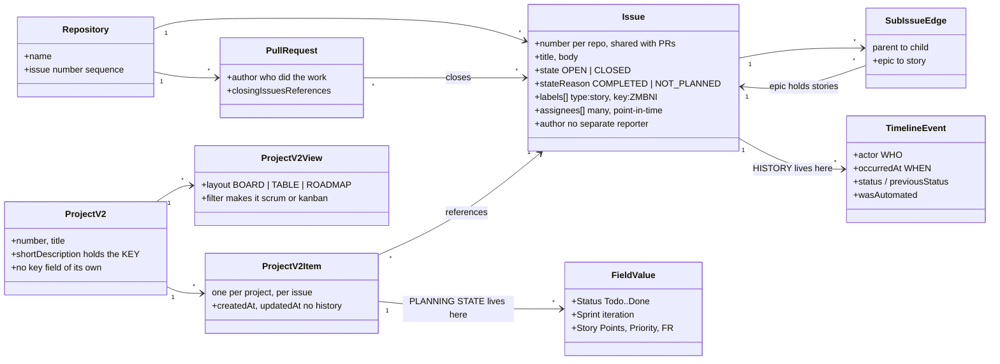

# gh-agile

A `gh` extension for running Agile work on GitHub Projects v2 — and, more to the
point, for **getting the data back out** in a form you can analyse the way you
would a Jira export.

```bash
gh extension install paulcaron16k/gh-agile

gh agile validate          # do the conventions hold?
gh agile export --csv      # backlog with status history
```

## The object model

Where each piece of state lives, and why some of it is on the project rather
than on the issue.



### Why the planning state is not on the issue

An issue has one `state` and it has two values: `OPEN` and `CLOSED`. There is no
`In Progress`, no story point, no sprint — GitHub does not model them, and issue
*fields*, which would, are organization-only.

So planning state lives on the **project item**: a join row between one project
and one issue, holding that project's values for that issue. Three consequences
follow, and every design decision in this tool descends from one of them.

- **The same issue on two projects has two independent sets of values.** Move it
  to Done on a team board and an engineering board still shows it In Progress,
  with nothing reporting the divergence. This is why boards are *views over one
  project* rather than separate projects.
- **A project cannot be a filter.** A filter has nowhere to put a value, so an
  item must exist before it can hold one — which is why `sync` exists and why
  nothing arrives on a board by matching a query.
- **Only `Status` has history.** `ProjectV2Item` carries `createdAt`,
  `updatedAt` and current values; the past lives on the *issue's* timeline as
  `ProjectV2ItemStatusChangedEvent`. Every other field's history must be
  reconstructed from snapshots.

`Sprint` is worse still: `ProjectV2Iteration` has no `id`, so any change to the
iteration configuration mints new ids and **clears every item's sprint
assignment**. This tool saves and re-applies them around any such change.

### Project properties this tool sets

| Property | Description | Value / enum |
|---|---|---|
| `title` | The board's name, as GitHub shows it | e.g. `gh-agile` |
| `shortDescription` | Human name **and key**, because ProjectV2 has no key field | `"<name> [<KEY>]"`, e.g. `gh-agile: Agile management on GitHub [AGILE]` |
| `number` | Assigned by GitHub; recorded in the profile as `project.number` and defaulted from there | integer |

### Field properties this tool sets

`setup` creates these on the project and converges them on every run.

| Field | Description | Value / enum |
|---|---|---|
| `Status` | Workflow state. Five, deliberately — every extra column is a decision someone has to make | `Todo`, `In Progress`, `Blocked`, `In Review`, `Done` |
| `Story Points` | Estimate. Number, not select, so it can be summed | number |
| `Priority` | Jira's five, so the two systems map without translation | `lowest`, `low`, `medium`, `high`, `highest` |
| `Sprint` | Iteration. Cadence and start day come from the profile | iteration, default 14 days |
| `FR` | Requirement traceability | free text, e.g. `FR-7.18` |

### Board properties this tool sets

A board is a **view**: a layout plus a filter. The filter is what makes it scrum
or kanban.

| Property | Description | Value |
|---|---|---|
| `name` | Identity for convergence — `setup` matches on it | e.g. `Team: AGILE only` |
| `layout` | How items are drawn | `BOARD_LAYOUT`, `TABLE_LAYOUT`, `ROADMAP_LAYOUT` |
| `filter` | The type's base filter, ANDed with any extra | scrum `sprint:@current` · kanban `-status:Done` · backlog `no:sprint -status:Done` · roadmap `label:type:epic` |

Live example from this repository's own board:

```
#2  Team: AGILE only       scrum    board  sprint:@current label:key:AGILE
#3  Engineering: all work  kanban   board  -status:Done
#4  Backlog                backlog  table  no:sprint -status:Done
```

**Column limits are not settable.** `ProjectV2View` exposes no limit field, so a
kanban board's WIP limits stay a web-UI setting.

### A complete view of one issue

Neither source is sufficient alone; a reader needs both.

| Property | Where | Description | Value / enum |
|---|---|---|---|
| `number` | issue | Per repository, shared with pull requests, never reused | integer |
| `issue_key` | derived | Jira-style identity, from the `key:` label or the profile | `ZMBNI-1817` |
| `title`, `body` | issue | Body carries `## Intent`, `## Acceptance`, `## Evidence` | markdown |
| `state` | issue | GitHub's only two | `OPEN`, `CLOSED` |
| `stateReason` | issue | Distinguishes finished from abandoned | `COMPLETED`, `NOT_PLANNED` |
| `labels[]` | issue | Type and key ride here, since issue types are org-only | `type:epic\|story\|bug`, `key:<KEY>` |
| `assignees[]` | issue | **Many**, where Jira has one. Point-in-time: developer, then reviewer, then QA | logins |
| `author` | issue | GitHub has no separate reporter field | login |
| `parent` | issue | The sub-issue edge — this is what an epic *is* | issue number |
| `closingIssuesReferences` | pull request | Names who did the work; the source of `worked_by` | PR number + author |
| `Status` | **project item** | Workflow state | see above |
| `Sprint` | **project item** | Iteration | sprint title |
| `Story Points`, `Priority`, `FR` | **project item** | Estimate, priority, traceability | see above |
| `started_at`, `done_at` | timeline | First `In Progress`, arrival at `Done` | timestamps |
| `worked_by` | derived | Closing PR's author, else who moved it to review/done | login |

## Why not just `gh project item-list`?

Because that gives you a **snapshot**. `ProjectV2Item` exposes `createdAt`,
`updatedAt` and the current field values — and nothing else. No history. So a
snapshot cannot answer when an item entered *In progress*, which is every flow
question worth asking.

The history does exist, but on the **issue timeline**, as
`ProjectV2ItemStatusChangedEvent` and `AddedToProjectV2Event`. `gh agile export`
runs both queries and joins them on the issue node ID, so each row carries:

| | |
|---|---|
| `added_to_board_at` | when the item joined the project |
| `started_at` | first transition to *In progress* |
| `done_at` | arrival at *Done* |
| `cycle_time_days` | `started_at` → `done_at` |
| `lead_time_days` | `added_to_board_at` → `done_at` |

plus every custom field flattened to a `field_*` column, the epic from the
sub-issue parent, labels, assignees and sub-issue roll-up counts.

Use `--no-history` to skip the per-issue timeline query. It is much faster and
the result is a snapshot with no cycle time — which is fine for a board dump and
useless for a flow report, so it is opt-in rather than the default.

## Getting started

[USER_GUIDE.md](USER_GUIDE.md) is the walkthrough: the project profile and every
property, creating a project, sprints, epics and stories, and the full workflow
from epic created to epic closed — with a section on driving it from an agent.

The profile lives in **`.github/agile.json`**, visible and checked in:

```json
{ "keys": { "owner/repo": "ZMBNI" },
  "project": { "name": "Zamboni Iceberg table maintainer", "key": "ZMBNI" } }
```

A repository that is not the main one carries only `{"config_from": "owner/main-repo"}`.

## The fields it creates

`gh agile setup` is idempotent and converges: it creates what is missing and
adds missing *options* to a single-select that already exists, never removing
one — removing an option silently clears the field on every item holding it.

| Field | Type | Gold model |
|---|---|---|
| `Story Points` | number | `story_points` |
| `Priority` | single-select — `lowest…highest` | `priority_id` |
| `FR` | text | requirement traceability |
| `Sprint` | iteration | `sprint_id` |
| `Status` | single-select — `Todo`, `In Progress`, `Blocked`, `In Review`, `Done` | `state_id` |

`Status` exists on every new project with three options; the other two are added,
because `blocked_hours` and `review_hours` are computed from time spent in them
and are otherwise permanently null. Epic, parent and sub-issue progress need no
custom field — GitHub provides them natively.

## Jira-style keys

GitHub projects have a `title` and a `shortDescription` and **no key of any
kind**. Since the issue-number sequence is per *repository* — and a project can
span repositories — the key is recorded per repository:

```bash
gh agile key --repo paulcaron16k/Zamboni --key ZMBNI
gh agile key --repo paulcaron16k/gh-agile --key AGILE \
         --name "gh-agile: Agile management on GitHub"
gh agile key                                    # list what is recorded
```

The export then carries `issue_key` — `AGILE-14`, `ZMBNI-1817` — which is the
Gold model's `issue_key`. Without a recorded key it falls back to
`owner/repo#14`, so the column is never empty. `--name` additionally writes
`"<name> [<KEY>]"` to the project's `shortDescription`, the nearest thing GitHub
has to a place for the pair.

## Export: silver tables, three grains

**What is exported is silver.** `github_issues` and `github_events` are GitHub's
facts under GitHub's names. The Gold `agile_*` tables belong to the
ExperienceFlow model and are produced by a **silver → gold transform in the IWS
Partner pipeline** — the place where `org_master_employees` exists to resolve a
login into an `actor_id`. Nothing here writes an `agile_*` file, and the `github_`
prefix is the reminder.

The transform is not cosmetic. Of the Gold model's 58 `agile_issues` fields only
two names match, and where they do the **units differ**: `cycle_time_days`
against `cycle_time_hours`, a factor of 24 that corrupts a dashboard quietly
rather than failing loudly. Events fare better — 14 of 22 — having been built to
Gold's vocabulary. See [GOLD_MODEL.md](GOLD_MODEL.md).

| Grain | Rows | Refresh |
|---|---|---|
| `github_issues` | one per work item, fields flattened, joined to status history | incremental |
| `github_events` | one per timeline event, with actor and timestamp | incremental |
| `github_project`, `github_boards`, `github_sprints` | the configuration | **always full** |

```bash
gh agile export --grain all --csv --out-dir exports/   # everything
gh agile export --grain both --csv --out-dir exports/  # issues + events
gh agile export --grain master --csv --out-dir exports/
```

Master data is small, changes rarely, and is reloaded whole every time. A
watermark over it would be a way to miss the one change that mattered — a
board's filter edited, a key added — so the question of what changed belongs to
the loader.

### Incremental, for the two large grains

```bash
gh agile export --grain both --csv --out-dir exports/   # since the watermark
gh agile export --since 2026-08-01T00:00:00Z            # explicit override
gh agile export --no-state                              # always full
```

Files are named `agile_issues_<ISO8601 basic>.csv` — `agile_issues_20260814T184850Z.csv`
— which has no colons, so it is a legal filename everywhere, and still sorts
lexicographically. A loader can import a directory in order without parsing the
names. Each row also carries `exported_at`, so concatenated exports keep their
ordering without re-deriving it from a path.

State lives in `.gh_agile_export.json`, keyed by `owner/project`, so one file can
track several boards:

```json
{ "paulcaron16k/4": { "last_export_at": "…", "watermark": "…", "rows": 4 } }
```

**The watermark is deliberately pulled back**, by `--overlap-seconds` (default
900). A status change takes time to reach the timeline — measured at ~75s and
variable — so an item whose `updatedAt` has already moved may still be missing
its newest event. Cutting exactly at the last watermark would skip that event
permanently, because the item never updates again. Re-reading a window emits the
row twice, which the target resolves latest-wins on its primary key. **A
duplicate is free; a hole is not.**

Incrementality does not reduce the items query, which has no server-side
`updatedAt` filter and is fetched in full. It reduces the *timeline* queries,
which are one per issue and the real cost.

> JSON rather than the `.yml` the design sketch suggested: there is no YAML
> parser in the standard library, and a partial one that reads only what this
> tool writes is a trap the first time someone edits it by hand.

## What it does not do

**Custom-field history.** GitHub emits a timeline event when `Status` changes
and for nothing else, so the history of points, sprint or priority has to be
reconstructed by diffing scheduled exports. `ProjectV2Iteration` carries no id
either, which is why any sprint-configuration change clears every assignment and
why this tool saves and re-applies them.

**WIP limits.** `ProjectV2View` exposes no limit field. A kanban board's column
limits stay a web-UI setting.

**Issue types and issue fields.** Both organization-only —
`/repos/{owner}/{repo}/issues/types` returns 404 on a user-owned repository and
`createIssueField` resolves only an Organization node. Type and key therefore
ride labels: `type:story`, `key:ZMBNI`.

**Pull requests, reviews and review comments** are not yet a grain of their own.
Issue-linked PR events are exported as `change-request-opened`; the rest is
tracked as AGILE-37.

**Dependencies.** Not a limitation so much as a rule: `gh extension install`
clones the repository and installs nothing, so this stays standard library only.
Analysis that needs DuckDB lives in `scripts/agile_analytics.py`, which declares
it through PEP 723 and runs under `uv`.

## Requirements

`gh`, authenticated with `project` scope:

```bash
gh auth refresh -s project
```

Python 3.9+. Standard library only — no dependencies, and no token is ever read,
stored or passed by this tool. Authentication is `gh`'s job.

## Mapping to the Gold Agile data model

[GOLD_MODEL.md](GOLD_MODEL.md) maps every column onto ExperienceFlowAI's
`agile_issues` and `agile_events`, so GitHub and Jira land in one shape. It also
records the two things measurement turned up rather than documentation:
GitHub emits **no event for a Projects v2 custom field change** (only Status has
one), and the timeline is **eventually consistent** — a transition can take a
minute or more to become readable.

## The rules it enforces

`gh agile validate` checks what a machine can: every story has an epic, every
epic has stories, statuses come from the declared set, closed items are *Done*
and open ones are not, and everything carries a `type:` label. The conventions
themselves — and which parts a person owns rather than a machine — are in
[POLICY.md](POLICY.md).
