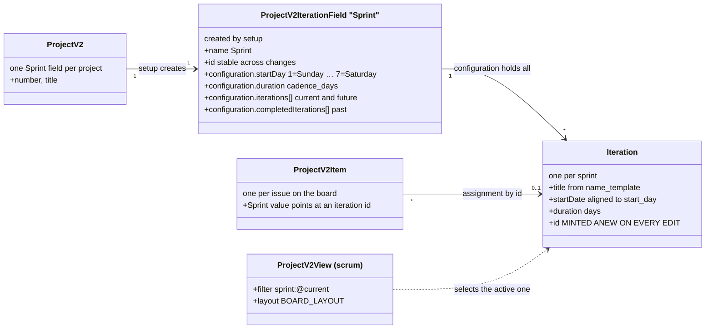

# gh-agile

A `gh` extension for running Agile work on GitHub Projects v2 — and, more to the
point, for **getting the data back out** in a form you can analyse the way you
would a Jira export.

```bash
gh extension install paulcaron16k/gh-agile

gh agile validate          # do the conventions hold?
gh agile export --csv      # backlog with status history
```

## The object model

Where each piece of state lives, and why some of it is on the project rather
than on the issue.


### Why the planning state is not on the issue

An issue has one `state` and it has two values: `OPEN` and `CLOSED`. There is no
`In Progress`, no story point, no sprint — GitHub does not model them, and issue
*fields*, which would, are organization-only.

So planning state lives on the **project item**: a join row between one project
and one issue, holding that project's values for that issue. Three consequences
follow, and every design decision in this tool descends from one of them.

- **The same issue on two projects has two independent sets of values.** Move it
  to Done on a team board and an engineering board still shows it In Progress,
  with nothing reporting the divergence. This is why boards are *views over one
  project* rather than separate projects.
- **A project cannot be a filter.** A filter has nowhere to put a value, so an
  item must exist before it can hold one — which is why `sync` exists and why
  nothing arrives on a board by matching a query.
- **Only `Status` has history.** `ProjectV2Item` carries `createdAt`,
  `updatedAt` and current values; the past lives on the *issue's* timeline as
  `ProjectV2ItemStatusChangedEvent`. Every other field's history must be
  reconstructed from snapshots.

`Sprint` is worse still: `ProjectV2Iteration` has no `id`, so any change to the
iteration configuration mints new ids and **clears every item's sprint
assignment**. This tool saves and re-applies them around any such change.

### Project properties this tool sets

| Property | Description | Value / enum |
|---|---|---|
| `title` | The board's name, as GitHub shows it | e.g. `gh-agile` |
| `shortDescription` | Human name **and key**, because ProjectV2 has no key field | `"<name> [<KEY>]"`, e.g. `gh-agile: Agile management on GitHub [AGILE]` |
| `number` | Assigned by GitHub; recorded in the profile as `project.number` and defaulted from there | integer |

### Field properties this tool sets

`setup` creates these on the project and converges them on every run.

| Field | Description | Value / enum |
|---|---|---|
| `Status` | Workflow state. Five, deliberately — every extra column is a decision someone has to make | `Todo`, `In Progress`, `Blocked`, `In Review`, `Done` |
| `Story Points` | Estimate. Number, not select, so it can be summed | number |
| `Priority` | Jira's five, so the two systems map without translation | `lowest`, `low`, `medium`, `high`, `highest` |
| `Sprint` | Iteration. Cadence and start day come from the profile | iteration, default 14 days |
| `FR` | Requirement traceability | free text, e.g. `FR-7.18` |

### Board properties this tool sets

A board is a **view**: a layout plus a filter. The filter is what makes it scrum
or kanban.

| Property | Description | Value |
|---|---|---|
| `name` | Identity for convergence — `setup` matches on it | e.g. `Team: AGILE only` |
| `layout` | How items are drawn | `BOARD_LAYOUT`, `TABLE_LAYOUT`, `ROADMAP_LAYOUT` |
| `filter` | The type's base filter, ANDed with any extra | scrum `sprint:@current` · kanban `-status:Done` · backlog `no:sprint -status:Done` · roadmap `label:type:epic` |

Live example from this repository's own board:

```
#2  Team: AGILE only       scrum    board  sprint:@current label:key:AGILE
#3  Engineering: all work  kanban   board  -status:Done
#4  Backlog                backlog  table  no:sprint -status:Done
```

**Column limits are not settable.** `ProjectV2View` exposes no limit field, so a
kanban board's WIP limits stay a web-UI setting.

### A complete view of one issue

Neither source is sufficient alone; a reader needs both.

| Property | Where | Description | Value / enum |
|---|---|---|---|
| `number` | issue | Per repository, shared with pull requests, never reused | integer |
| `issue_key` | derived | Jira-style identity, from the `key:` label or the profile | `ZMBNI-1817` |
| `title`, `body` | issue | Body carries `## Intent`, `## Acceptance`, `## Evidence` | markdown |
| `state` | issue | GitHub's only two | `OPEN`, `CLOSED` |
| `stateReason` | issue | Distinguishes finished from abandoned | `COMPLETED`, `NOT_PLANNED` |
| `labels[]` | issue | Type and key ride here, since issue types are org-only | `type:epic\|story\|bug`, `key:<KEY>` |
| `assignees[]` | issue | **Many**, where Jira has one. Point-in-time: developer, then reviewer, then QA | logins |
| `author` | issue | GitHub has no separate reporter field | login |
| `parent` | issue | The sub-issue edge — this is what an epic *is* | issue number |
| `closingIssuesReferences` | pull request | Names who did the work; the source of `worked_by` | PR number + author |
| `Status` | **project item** | Workflow state | see above |
| `Sprint` | **project item** | Iteration | sprint title |
| `Story Points`, `Priority`, `FR` | **project item** | Estimate, priority, traceability | see above |
| `started_at`, `done_at` | timeline | First `In Progress`, arrival at `Done` | timestamps |
| `worked_by` | derived | Closing PR's author, else who moved it to review/done | login |

## Why not just `gh project item-list`?

Because that gives you a **snapshot**. `ProjectV2Item` exposes `createdAt`,
`updatedAt` and the current field values — and nothing else. No history. So a
snapshot cannot answer when an item entered *In progress*, which is every flow
question worth asking.

The history does exist, but on the **issue timeline**, as
`ProjectV2ItemStatusChangedEvent` and `AddedToProjectV2Event`. `gh agile export`
runs both queries and joins them on the issue node ID, so each row carries:

| | |
|---|---|
| `added_to_board_at` | when the item joined the project |
| `started_at` | first transition to *In progress* |
| `done_at` | arrival at *Done* |
| `cycle_time_days` | `started_at` → `done_at` |
| `lead_time_days` | `added_to_board_at` → `done_at` |

plus every custom field flattened to a `field_*` column, the epic from the
sub-issue parent, labels, assignees and sub-issue roll-up counts.

Use `--no-history` to skip the per-issue timeline query. It is much faster and
the result is a snapshot with no cycle time — which is fine for a board dump and
useless for a flow report, so it is opt-in rather than the default.

## Getting started

[USER_GUIDE.md](USER_GUIDE.md) is the walkthrough: the project profile and every
property, creating a project, sprints, epics and stories, and the full workflow
from epic created to epic closed — with a section on driving it from an agent.

The profile lives in **`.github/agile.json`**, visible and checked in:

```json
{ "keys": { "owner/repo": "ZMBNI" },
  "project": { "name": "Zamboni Iceberg table maintainer", "key": "ZMBNI" } }
```

A repository that is not the main one carries only `{"config_from": "owner/main-repo"}`.

## The fields it creates

`gh agile setup` is idempotent and converges: it creates what is missing and
adds missing *options* to a single-select that already exists, never removing
one — removing an option silently clears the field on every item holding it.

| Field | Type | Gold model |
|---|---|---|
| `Story Points` | number | `story_points` |
| `Priority` | single-select — `lowest…highest` | `priority_id` |
| `FR` | text | requirement traceability |
| `Sprint` | iteration | `sprint_id` |
| `Status` | single-select — `Todo`, `In Progress`, `Blocked`, `In Review`, `Done` | `state_id` |

`Status` exists on every new project with three options; the other two are added,
because `blocked_hours` and `review_hours` are computed from time spent in them
and are otherwise permanently null. Epic, parent and sub-issue progress need no
custom field — GitHub provides them natively.

## Jira-style keys

GitHub projects have a `title` and a `shortDescription` and **no key of any
kind**. Since the issue-number sequence is per *repository* — and a project can
span repositories — the key is recorded per repository:

```bash
gh agile key --repo paulcaron16k/Zamboni --key ZMBNI
gh agile key --repo paulcaron16k/gh-agile --key AGILE \
         --name "gh-agile: Agile management on GitHub"
gh agile key                                    # list what is recorded
```

The export then carries `issue_key` — `AGILE-14`, `ZMBNI-1817` — which is the
Gold model's `issue_key`. Without a recorded key it falls back to
`owner/repo#14`, so the column is never empty. `--name` additionally writes
`"<name> [<KEY>]"` to the project's `shortDescription`, the nearest thing GitHub
has to a place for the pair.

## Sprint management

A sprint is a GitHub **iteration**: one entry in the configuration of the
project's `Sprint` iteration field. There is one such field per project, created
by `setup`, and every sprint the team will ever have — past, current and
future — lives inside it.

That single shared configuration is the fact everything else here follows from.



**An iteration has an `id` you must point at, and no `id` you may send.**
`ProjectV2Iteration` — the input object the configuration mutation accepts, and
an input object despite the name — carries `startDate`, `duration` and `title`.
The configuration is therefore replaced wholesale on every write, GitHub mints
fresh ids for *every* iteration, and every item's `Sprint` value points at an id
that no longer exists.

**Every sprint is effectively immutable, and there is no safe write.** Measured
on a live project with four items staged across a completed sprint, the current
one and a far-future one:

```
rename ONE unused future sprint ("Sprint 2", nothing assigned to it)
  ids before   ca18398f ead192f4 3a48fbb6 99c4d925 a9588b10 173fd868
  ids after    87a9a138 270baf8d 5ce62516 36ae4f17 035fd273 4a7d50f8
  closed issue in the COMPLETED sprint   -> UNASSIGNED
  draft in the current sprint            -> UNASSIGNED
  draft in a future sprint               -> UNASSIGNED
```

A closed issue in a finished sprint lost its assignment because an unrelated,
unused, future sprint was renamed. And it is not renaming that does it — a pure
**append**, re-sending every existing entry byte-identical and adding one at the
end, clears them all just the same:

```
append "Sprint 6", every existing entry unchanged
  all three probes -> UNASSIGNED
```

That append is the routine fortnightly act. So every two weeks the board's
entire sprint history is destroyed and rebuilt by this tool's save-and-restore,
which costs one API call per assigned item and **is not transactional**: during
testing the GraphQL budget ran out partway through a restore and the remaining
assignment was simply lost.

### The sprint an issue was worked in is recorded on the issue

Because of the above, the `Sprint` field is treated as *live UI state, not
history*. The durable record is a label on the issue — `sprint:2026-08-10`,
dated rather than named, because a title is cosmetic and editable while the
start date is the sprint's identity, and because dates sort.

`move` writes it when work starts and again when it finishes, so an item carried
across a boundary carries both:

```
gh agile move 53 --status "In Progress"       #53 + sprint:2026-08-10
gh agile move 53 --status Done --close        #53 + sprint:2026-08-24
```

Issues that predate the stamping are recovered with `gh agile sprint backfill`,
which maps Status transitions into the sprint containing them. Prefer it over
`--source field`: on this project the field could recover 2 of 25 items, and for
one of those it was wrong — `#36` finished on 2026-08-15 while its field read a
sprint starting 08-17. The field records where an item is planned; the timeline
records where it was worked.

The export carries `sprint_starts` (every sprint the issue lived in, oldest
first) and `sprint_closed_in` beside the live `field_sprint`. Demonstrated by
renaming an unused future sprint and exporting immediately afterwards:

```
field_sprint      = ''                          ← the project item's memory, wiped
sprint_starts     = '2026-08-10;2026-08-24'     ← intact
sprint_closed_in  = '2026-08-24'
```

**The field is repaired from the labels, automatically.** Every write that
clears assignments — `setup` converging the cadence, `sprint ensure`,
`sprint create` — restores from a snapshot and then heals from the labels, in
that order, in the same run. The snapshot covers items the labels know nothing
about; the heal covers what the snapshot could not put back, including a run that
died partway. `gh agile sprint reconcile` does it on demand, for a change made
outside the tool.

Only **empty** fields are filled in. A field that disagrees with its labels is
somebody's decision — an open story re-planned into a future sprint has labels
recording where it was *worked* — so it is reported and left alone unless
`--overwrite` is given. On the board this was written for, the first run repaired
14 of 16 labelled items whose field had been silently cleared by earlier sprint
creation.

Where they disagree, believe the labels. The field holds one value and forgets;
the labels are immutable, live on the issue rather than the project item, and
survive removal from the board, deletion of the project, and every iteration
write. Set `sprint.record_label: false` to turn it off.

The field still earns its place: `sprint:@current` is what makes a scrum board
show the current sprint, and no label can do that without being edited every
fortnight. Field for the board, labels for the record.

### Properties this tool sets

| Object | Created by | Properties |
|---|---|---|
| `Sprint` field | `setup` | `duration` = `cadence_days`, converged on every run — existing sprints keep their dates, only later ones use a changed cadence. **`startDay` is left alone**: the configuration input does not accept it, and GitHub does not derive it from a start date — sending a Monday left the field reporting Sunday. It only affects what the web UI suggests, so `start_day` governs what this tool aligns, not what GitHub stores |
| Iteration | `sprint create`, `sprint ensure`, `move` | `title` from `name_template`, `startDate` aligned to `start_day`, `duration` = `cadence_days` |
| Item `Sprint` value | `set --field Sprint`, `move` to `In Progress` | The iteration's id, resolved from a title or `@current`. Cleared by any iteration write — live state, not history |
| `sprint:YYYY-MM-DD` label | `move` at `In Progress` and at `Done` | The sprint's start date. On the issue, immutable, one per sprint the issue lived in |
| Scrum board | `setup`, `board create --type scrum` | `filter: sprint:@current`, which is what makes a board scrum rather than kanban |

Profile settings, all under `sprint`:

| Property | Default | Description |
|---|---|---|
| `template` | — | Chosen deliberately; `epic`, `story` and `sprint ensure` refuse until it is set |
| `cadence_days` | `14` | Sprint length, 1–30. `"2-week"` is accepted and normalised |
| `start_day` | `"monday"` | Weekday new sprints begin on |
| `ahead` | `2` | Future sprints kept stocked |
| `autocreate` | `true` | Whether `move` may create the covering sprint when none is active |
| `name_template` | `"{key} Sprint {n}"` | `{n}`, `{key}`, `{start}`, `{end}`, `{year}`, `{iso_week}` |
| `record_label` | `true` | Stamp `sprint:YYYY-MM-DD` on the issue when work starts and finishes |

### Requirements, and how each is met

| # | Requirement | How |
|---|---|---|
| 1 | A sprint always covers today | `ensure` places one aligned to `start_day`, snapping back so a sprint created on a Wednesday still begins Monday and covers today |
| 2 | **Two future sprints** are stocked | `ahead: 2`. Jira's model: the backlog holds future sprints, so starting work never has to change the project's configuration |
| 3 | Sprints are created **on demand, never on a clock** | Nothing schedules sprint creation. `ensure` runs when a person or an agent runs it, and `move` to `In Progress` creates the covering sprint if none is active and `autocreate` is on |
| 4 | Idle time leaves **no sprints and no futures** | A consequence of 3. Stop work for four months and no sprints exist for those months, because nothing was running to make them. Resume, and `move` creates the one covering that day plus two ahead |
| 5 | Gaps are **skipped, not backfilled** | `ensure` creates the sprint covering today, not the ones that would have run since. Numbering jumps — `Sprint 2` to `Sprint 5` — which is the honest record: nobody worked in 3 and 4. Jira does the same |
| 6 | Every sprint starts on the same weekday | `aligned_start` snaps back to the most recent `start_day`. Snapping forward would drift the boundary across weekdays until no two sprints agreed |
| 7 | No two sprints overlap | Placement tests **intersection**, not containment. An early version tested containment, read a partial overlap as uncovered, and created three overlapping sprints on a live board — which makes `@current` ambiguous, the one thing it exists to resolve |
| 8 | `ensure` is idempotent | It computes the shortfall against what exists. An early version created `ahead + 1` every run |
| 9 | Assignments survive a configuration change | Read before, re-applied after — see above. Anything that could not be re-applied is named on stderr |
| 10 | Starting work assigns the current sprint | `move --status "In Progress"` sets `Sprint` if the item has none. Otherwise in-progress work sits outside every sprint and the sprint report quietly omits it |
| 11 | The sprint an issue was worked in **survives** | A `sprint:YYYY-MM-DD` label on the issue. The `Sprint` field cannot be relied on for history: any iteration write clears it board-wide, including for closed issues in completed sprints |
| 12 | The field is repaired, not just reported | `gh agile sprint reconcile` sets each item's `Sprint` from its labels, latest winning. Safe to automate: it copies a recorded fact back into a field GitHub cleared, and invents nothing |
| 13 | Carryover is visible | An issue worked across a boundary carries a label per sprint. The field holds only the latest |
| 14 | Issues created outside the tool are upgraded | `gh agile sync --adopt`, or `templates/issue-adopt.yml` — see below |

**Why not a cron.** A scheduled `sprint ensure` satisfies requirement 2 and
breaks requirement 4: it manufactures sprints through a quiet quarter, leaving a
row of empty iterations nobody planned and a burndown that reports absence as
activity. Requirement 3 is what reconciles them — the series is driven by work.

### Issues created outside the tool

An issue opened in the web UI, by a bot, or with plain `gh issue create` arrives
with none of the convention: no `key:` label, no `type:` label, and no project
item at all — so no Status, no Sprint, and no column on any board.

```bash
gh agile sync --dry-run          # what is missing, changing nothing
gh agile sync --adopt            # add to the board, set key: label and Status=Todo
```

`--adopt` fills the two gaps a machine can fill. **It does not set `type:`.**
Nothing in an issue distinguishes an epic from a story from a bug, and a guessed
label later reads as somebody's decision; `gh agile validate` reports it and a
person closes it.

To do it on issue creation rather than before planning, copy
`templates/issue-adopt.yml` into each repository. It needs a `PROJECT_TOKEN`
secret: writing to a project is outside the default `GITHUB_TOKEN`'s reach
whatever permissions block you write, unlike labelling an issue. If you would
rather hold no token, run `sync --adopt` before each planning meeting; the only
difference is latency.

### Incompatibilities with the GitHub web GUI

Everything below was checked against the live API, not inferred.

| What | Consequence |
|---|---|
| **Editing any sprint re-mints every iteration id** | Every item's `Sprint` value is cleared, including items in sprints you did not edit. This tool saves and re-applies them; the web UI gives you no such protection, and there is no undo |
| **Built-in project workflows cannot be enabled through the API** | The schema has `deleteProjectV2Workflow` and no create or update. `setup` can neither turn them on nor converge them, so *every* project automation is a manual web-UI step |
| **A user-owned project has no auto-add-issues workflow** | The six built-ins are: auto-add sub-issues to project, auto-close issue, item added to project, item closed, pull request linked to issue, pull request merged. Nothing puts a newly opened repository issue on the board — hence `sync` |
| **The series anchor is write-only** | `ProjectV2IterationFieldConfigurationInput` takes `startDate`, `duration`, `iterations`; the readable `ProjectV2IterationFieldConfiguration` exposes `startDay`, `duration`, `iterations`, `completedIterations` — and no `startDate`. You cannot read back the anchor you sent |
| **A sprint created in the web UI can be any length, on any day** | It may overlap what this tool would place. `ensure` then reports that it cannot place a sprint without overlapping, and creates nothing |
| **Column and WIP limits are not settable** | `ProjectV2View` exposes no limit field; they stay a web-UI setting |

### Best practice

**Safe in the web UI** — these are per-item values, and touch no shared
configuration:

- Dragging a card between columns, and setting Status, Sprint, Points, Priority
  or assignees on an item.
- Editing a board's filter, layout and visible fields.
- Writing issue bodies and comments.

**Do in the tool, not the web UI:**

- Creating sprints — `gh agile sprint ensure`, or let `move` create one.
- Renaming or re-dating a sprint. There is no safe web-UI path: it clears
  assignments board-wide. Prefer changing `name_template`, which affects only
  sprints created afterwards and leaves existing ones alone.
- Creating fields and boards — `setup` converges them; a hand-made one drifts.

**Two manual steps the API cannot do for you.** Enable the built-in *Item added
to project* workflow to set `Status` on anything added by any path, and, if you
want the board to show who is working on a card, the automations described in
`templates/`. Both are web-UI toggles.

**After a web-UI session, run `gh agile validate`.** It is the cheapest way to
find an item that lost its sprint, a story with no epic, or a closed issue whose
status never reached Done.

## Export: silver tables, three grains

**What is exported is silver.** `github_issues` and `github_events` are GitHub's
facts under GitHub's names. The Gold `agile_*` tables belong to the
ExperienceFlow model and are produced by a **silver → gold transform in the IWS
Partner pipeline** — the place where `org_master_employees` exists to resolve a
login into an `actor_id`. Nothing here writes an `agile_*` file, and the `github_`
prefix is the reminder.

The transform is not cosmetic. Of the Gold model's 58 `agile_issues` fields only
two names match, and where they do the **units differ**: `cycle_time_days`
against `cycle_time_hours`, a factor of 24 that corrupts a dashboard quietly
rather than failing loudly. Events fare better — 14 of 22 — having been built to
Gold's vocabulary. See [GOLD_MODEL.md](GOLD_MODEL.md).

| Grain | Rows | Refresh |
|---|---|---|
| `github_issues` | one per work item, fields flattened, joined to status history | incremental |
| `github_events` | one per timeline event, with actor and timestamp | incremental |
| `github_project`, `github_boards`, `github_sprints` | the configuration | **always full** |

```bash
gh agile export --grain all --csv --out-dir exports/   # everything
gh agile export --grain both --csv --out-dir exports/  # issues + events
gh agile export --grain master --csv --out-dir exports/
```

Master data is small, changes rarely, and is reloaded whole every time. A
watermark over it would be a way to miss the one change that mattered — a
board's filter edited, a key added — so the question of what changed belongs to
the loader.

### Incremental, for the two large grains

```bash
gh agile export --grain both --csv --out-dir exports/   # since the watermark
gh agile export --since 2026-08-01T00:00:00Z            # explicit override
gh agile export --no-state                              # always full
gh agile export                                         # read it; watermark unmoved
```

**The watermark advances only on `--out-dir`.** It is a promise that everything
up to it has been delivered somewhere durable, and stdout is not: a bare export
piped into `less`, or into a script that then fails, must not tell the next
scheduled run those rows are handled. Reads to stdout stay incremental and say
what they left alone.

Files are named `github_issues_<ISO8601 basic>.csv` — `github_issues_20260814T184850Z.csv`
— which has no colons, so it is a legal filename everywhere, and still sorts
lexicographically. A loader can import a directory in order without parsing the
names. Each row also carries `exported_at`, so concatenated exports keep their
ordering without re-deriving it from a path.

State lives in `.gh_agile_export.json`, keyed by `owner/project`, so one file can
track several boards:

```json
{ "paulcaron16k/4": { "last_export_at": "…", "watermark": "…", "rows": 4 } }
```

**The watermark is deliberately pulled back**, by `--overlap-seconds` (default
900). A status change takes time to reach the timeline — measured at ~75s and
variable — so an item whose `updatedAt` has already moved may still be missing
its newest event. Cutting exactly at the last watermark would skip that event
permanently, because the item never updates again. Re-reading a window emits the
row twice, which the target resolves latest-wins on its primary key. **A
duplicate is free; a hole is not.**

Incrementality does not reduce the items query, which has no server-side
`updatedAt` filter and is fetched in full. It reduces the *timeline* queries,
which are one per issue and the real cost.

> JSON rather than the `.yml` the design sketch suggested: there is no YAML
> parser in the standard library, and a partial one that reads only what this
> tool writes is a trap the first time someone edits it by hand.

## What it does not do

**Custom-field history.** GitHub emits a timeline event when `Status` changes
and for nothing else, so the history of points, sprint or priority has to be
reconstructed by diffing scheduled exports. `ProjectV2Iteration` carries no id
either, which is why any sprint-configuration change clears every assignment and
why this tool saves and re-applies them.

**WIP limits.** `ProjectV2View` exposes no limit field. A kanban board's column
limits stay a web-UI setting.

**Project automations.** The schema has `deleteProjectV2Workflow` and nothing
that creates, enables or configures one, so `setup` cannot converge a project's
built-in workflows and every one of them stays a manual web-UI step — see
[Sprint management](#sprint-management).

**Issue types and issue fields.** Both organization-only —
`/repos/{owner}/{repo}/issues/types` returns 404 on a user-owned repository and
`createIssueField` resolves only an Organization node. Type and key therefore
ride labels: `type:story`, `key:ZMBNI`.

**Pull requests, reviews and review comments** are not yet a grain of their own.
Issue-linked PR events are exported as `change-request-opened`; the rest is
tracked as AGILE-37.

**Dependencies.** Not a limitation so much as a rule: `gh extension install`
clones the repository and installs nothing, so this stays standard library only.
Analysis that needs DuckDB lives in `scripts/agile_analytics.py`, which declares
it through PEP 723 and runs under `uv`.

## Team Usage

**Repository permission and project permission are two separate grants, and this
is the one thing to take away.** Write access to the repository does not give
write access to the board. Someone with push rights can open issues and create
labels and still be refused when the tool tries to add that issue to the
project — which is the middle of `epic` and `story`, not the end. Their token
also needs the `project` scope, which `repo` does not imply.

Three tiers follow from that, and they are what to grant against:

| Tier | Commands | Needs |
|---|---|---|
| Read | `export`, `validate`, `sprint list`, `board list`, `fix --dry-run` | project **read**, and `project.owner` in the profile |
| Day to day | `epic`, `story`, `set`, `move`, `sync`, `fix`, `sprint backfill`, `sprint reconcile` | project **write** + repo **push** (for labels and issue bodies) |
| Admin | `setup` (creates *fields*), `project create`, `sprint create`, `sprint ensure` | project **admin** — these change the project's schema |

`key` with no arguments is a local file read and works for anyone with a clone.

**The Read tier needs `project.owner` recorded in the profile**, or it silently
does not work for anyone but the board's owner: `--owner` falls back to whoever
ran the command, so a teammate looking for project 4 gets *their* project 4.
`gh agile project create` records it; for an older profile, run
`gh agile project owner` once and commit it.

### Personal account

One maintainer, a public repository, a public project. Contributors file issues;
the maintainer boards them.

**1. Repository public, issues enabled.**
Settings → General → Danger Zone → *Change repository visibility*, and
Settings → General → Features → *Issues*. Or:

```bash
gh repo edit OWNER/REPO --visibility public --accept-visibility-change-consequences
gh repo edit OWNER/REPO --enable-issues
gh repo view OWNER/REPO --json visibility,hasIssuesEnabled     # verify
```

**2. Project public.**
Project → ⋯ (top right) → Settings → *Visibility* → Public. Or:

```bash
gh project edit 4 --owner OWNER --visibility PUBLIC
gh api graphql -f query='{user(login:"OWNER"){projectV2(number:4){public}}}'   # verify
```

A public project is world-**readable**. There is no way to make it
world-writable, which is why the tiers above matter even here.

**3. `project` scope on the token.**

```bash
gh auth refresh -s project      # read:project is enough for the Read tier
gh auth status                  # verify: 'project' appears in Token scopes
```

**4. The two web-UI workflows.**
Project → ⋯ → *Workflows*. Enable **Item added to project** → set Status, so
anything reaching the board by any route gets a Status instead of a blank.

These cannot be enabled through the API — the GraphQL schema has
`deleteProjectV2Workflow` and nothing that creates or updates one — so this step
is manual, once, per project. And **auto-add repository issues is not among a
user-owned project's built-in workflows at all**, which is exactly why `sync`
exists: a project is a collection, not a filter, and an issue is not on the board
until something puts it there.

**5. Collaborators, if any.**
Project → Settings → *Manage access* → invite, with Read / Write / Admin.

The limitation to know before you build on this: **a user-owned project cannot be
shared with a team.** Access is granted to individuals, one at a time, forever.
If more than a couple of people need write access, that is the signal to move to
an organization.

**What a contributor gets in this setup.** They can open issues and comment. They
cannot add anything to the board, set a field, or create a label. Point them at
plain `gh issue create`; the maintainer picks the issue up with
`gh agile sync --adopt`, which sets the key and Status but deliberately never
guesses the `type:` label — a machine cannot tell an epic from a story from a
bug, so `validate` reports the gap and a person decides.

**Before making the board public**, read `docs/review-2026-08.md` S9. A public
repository exposes issue titles, bodies and comments. A public *project*
additionally exposes story points, priority, sprint assignment, and — via the
export anyone can then reproduce — the full status history and the cycle times
derived from it. That last one is an estimate-accuracy record about named people,
and it is the part nobody expects to be publishing.

### Organization

Worth the move for three reasons, one of which pays the tool back directly:

1. **Team sharing.** Org projects grant access to teams; user projects cannot.
2. **A real role model.** Admin / Write / Read, plus an org-wide base role.
3. **Issue Types and Issue Fields are organization-only** — `createIssueField`
   resolves only an Organization node. They are the reason `type:` and `key:`
   currently ride on labels, so an org could retire two of the three label
   conventions in favour of native fields.

What it does **not** fix: sprints are a *project* iteration field, not an issue
field. The iteration defect and all six workarounds survive the move unchanged.

**1. An organization-owned project.**
Organization → Projects → *New project*. Created under the org, not a member.

**2. The org-wide base role for projects.**
Organization Settings → Planning (Projects) → *Base permissions*: No access /
Read / Write / Admin. This is the default every member gets, so set it to the
least useful tier that works — Read — and grant Write per team.

**3. Team access to the project.**
Project → Settings → *Manage access* → add the team, with its role.

**4. Repository push for the same people.**
Labels need push (or triage) on the repository, and the Day-to-day tier writes
labels. Project write alone will fail at label creation — and today it fails
*quietly*, reporting "already exists" (see `docs/review-2026-08.md` S1).

**5. Token scopes, and SSO if the org enforces SAML.**
Each member runs `gh auth refresh -s project`. Under SAML the token must also be
authorized for the organization, or every call fails with a resource error that
does not mention SSO.

**Status of organization support: the code path is fixed; the permission tiers
are not verified.**

`gh-agile` has only ever been run against user-owned projects, and until
2026-08-23 an org-owned one would have failed early. `gh api graphql` exits
non-zero when GraphQL returns an `errors` block, which is what asking
`user(login:)` about an organization does — so `project_id` and `sprint_field`,
which walked `user` then `organization` without catching it, died on the first
root and reported *"Could not resolve to a User with the login of 'acme'"* for a
login that was correct. All three callers now share `project_node`, which does
the walk with the catch once. `docs/review-2026-08.md` S8 has the measurement.

What is **still** unverified is the table at the top of this section: whether
project *Write* covers field creation, iteration configuration and view creation,
or whether `setup`, `sprint create` and `board create` need *Admin*. That cannot
be worked out by reading the schema — it needs an org with a second account at
Write. Treat the Admin row as informed guesswork until someone measures it.

## Requirements

`gh`, authenticated with `project` scope:

```bash
gh auth refresh -s project
```

Python 3.12 or newer. Standard library only — no dependencies, and no token is
ever read, stored or passed by this tool. Authentication is `gh`'s job.

## Mapping to the Gold Agile data model

[GOLD_MODEL.md](GOLD_MODEL.md) maps every column onto ExperienceFlowAI's
`agile_issues` and `agile_events`, so GitHub and Jira land in one shape. It also
records the two things measurement turned up rather than documentation:
GitHub emits **no event for a Projects v2 custom field change** (only Status has
one), and the timeline is **eventually consistent** — a transition can take a
minute or more to become readable.

## The rules it enforces

`gh agile validate` checks what a machine can: every story has an epic, every
epic has stories, statuses come from the declared set, closed items are *Done*
and open ones are not, and everything carries a `type:` label. The conventions
themselves — and which parts a person owns rather than a machine — are in
[POLICY.md](POLICY.md).
