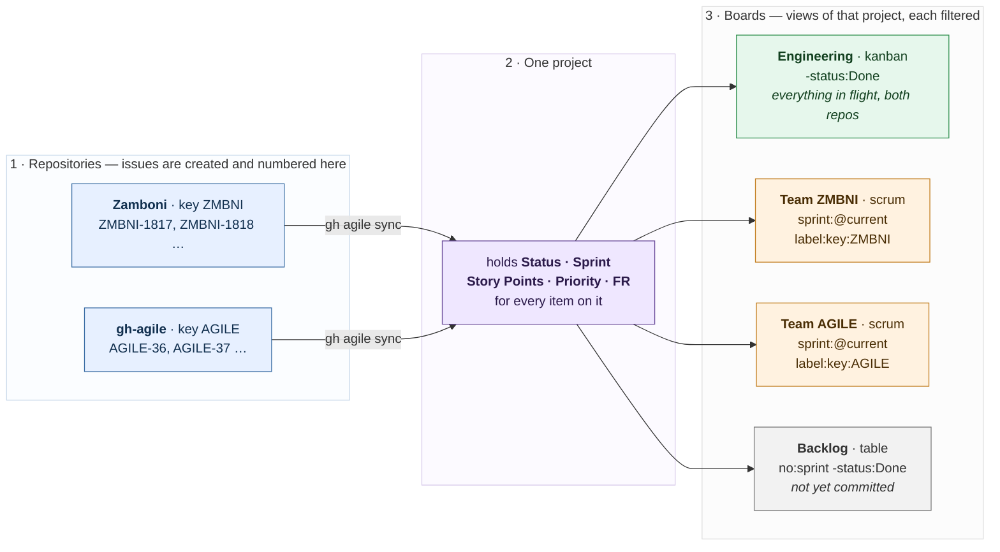
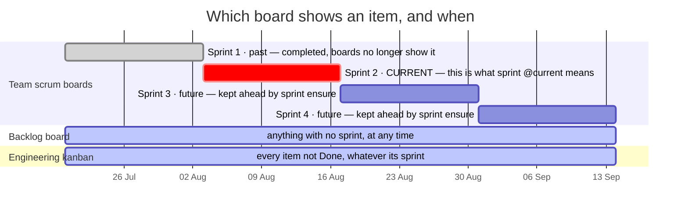

# gh-agile user guide

Setting up a board, and the commands for a real day's work — including the one
that takes an epic from created to closed. Written so a person can follow it and
an agent can run it on a developer's behalf.

The *rules* are in [POLICY.md](POLICY.md); the *data mapping* is in
[GOLD_MODEL.md](GOLD_MODEL.md). This is the *how*.

---

## 1. The project profile

One JSON file describes the project to the tool. It is **visible, checked in,
and reviewed like any other config**:

```
.github/agile.json
```

A dotfile would be the conventional choice for tooling and the wrong one here.
`ls` does not show it, so someone cloning the repo never learns the convention
exists — and a convention nobody discovers is not a convention. `.github/` is
already where people look for repository metadata, and the file sits beside the
workflows that read it.

### Properties

| Property | Type | Required | Description |
|---|---|---|---|
| `keys` | **ordered list** | yes | One entry per key: `{"key", "name", "repo"}`. **The order is the default** — the first entry for a repository is the key used when `--key` is not given |
| `keys[].key` | string | yes | Short uppercase key, `[A-Z0-9]+`. No hyphen: the hyphen separates key from number in `ZMBNI-34` |
| `keys[].repo` | string | yes | `owner/name` the key applies to. Several keys may name the same repo — see Mono-repo support |
| `keys[].name` | string | no | What that key is for, shown by `gh agile key` |
| `project.number` | integer | no | The board's **number**, not its node id — what `--project` takes. Written by `gh agile project create`, and what every command defaults to |
| `project.owner` | string | no | **The account that holds the project**, and what `--owner` defaults to. Written by `gh agile project create`; `gh agile project owner` adds it to an older profile. Without it a number means "project N belonging to whoever ran this", which is only ever right for one person — see below |
| `project.name` | string | no | Human-readable project name |
| `project.key` | string | no | The main repository's key; a convenience copy of the matching `keys` entry |
| `project.issue_title_prefix` | `off` \| `key` \| `key+type` | no | Whether new issue titles carry `KEY-ID` and the type — see Issue titles. Default `off`; an unrecognised value stops every command |
| `config_from` | string | no | `owner/repo` holding the real profile. **Carries nothing else** |

```json
{
  "keys": [
    { "key": "ZMBNI", "name": "Zamboni Iceberg table maintainer", "repo": "paulcaron16k/Zamboni" },
    { "key": "SPARK", "name": "Zamboni Spark maintainer",         "repo": "paulcaron16k/Zamboni" },
    { "key": "TRINO", "name": "Zamboni Trino maintainer",         "repo": "paulcaron16k/Zamboni" },
    { "key": "AGILE", "name": "GitHub Agile extension",           "repo": "paulcaron16k/gh-agile" }
  ],
  "project": {
    "number": 5,
    "owner": "paulcaron16k",
    "name": "Zamboni Iceberg table maintainer",
    "key": "ZMBNI"
  }
}
```

**A project number is not an identity without its owner.** `project.number: 5`
on its own means "project 5 belonging to whoever typed this", because `--owner`
used to default to the caller. For the person who created the board that is
invisibly correct. For anybody else it resolves to nothing — so `export`,
`validate`, `sprint list` and `board list` fail even for someone who has project
read access — or, worse, it resolves to an unrelated project 5 of *their* own,
and then `sync --adopt` labels issues onto it.

So record the owner. `project create` does it from now on; for a profile written
before that:

```bash
gh agile project owner                  # records you
gh agile --owner some-org project owner  # records an organization
```

Precedence is: `--owner` if given, then `project.owner`, then you. `--owner @me`
always means you, even when the profile names someone else. An explicit
`--owner` that *disagrees* with `project.owner` is refused, for the same reason a
disagreeing `--project` is: the keys, boards and sprint cadence in this profile
belong to the board it describes and not to whatever `--owner` points at.

**The key belongs to the repository, not the project.** GitHub's issue numbers
are a per-repository sequence and a project may span repositories, so a
project-level key would make `KEY-12` ambiguous the moment a second repository
joined the board.

A key gives the Jira equivalent of `{PROJECT_KEY}-{ISSUE_ID}`: **`ZMBNI-34`
identifies a repository and an issue in one string**, and is accepted anywhere
an issue number is.

### How an issue's key is decided, and where it is stored

**Explicitly, on the issue, as a label — `key:ZMBNI`.** Written at creation by
`epic` and `story`, so it is recorded rather than inferred.

GitHub Issue Fields would be the natural home and are unavailable:
`createIssueField` requires an **Organization** owner and refuses a user
account, the same limitation as Issue Types. A label is the next best carrier —
it lives on the issue rather than the board, shows in the UI, survives removal
from a project, and is filterable with `is:issue label:key:ZMBNI`.

On export, `issue_key` uses the `key:` label when present, and otherwise falls
back to the **first** profile key for that issue's repository.

### Mono-repo support

A product in one repository with several services — which would be separate
repos, or separate Jira projects with their own keys — can list **several keys
against the same repo**. `--key SPARK` on creation labels the issue
`key:SPARK`, and it exports as `SPARK-41`.

The ids are not monotonic per key: `ZMBNI-34` may be followed by `SPARK-35`,
because all keys share one repository sequence. That is a cosmetic difference
from Jira and a real advantage — the numbers **cannot collide**, where Jira's
per-project sequences require the key to disambiguate them.

### Where to check it in when a project spans repositories

**Put the real profile in the main repository** — the one whose name the project
carries, where most issues are filed. Supporting repositories carry a pointer
and nothing else:

```json
{ "config_from": "paulcaron16k/Zamboni" }
```

Resolved through the API, so it works for private repositories on the token `gh`
already holds, and cannot rot into a dead raw-content URL. One hop only: a
pointer to a pointer is a loop waiting to happen, so the tool ignores
`config_from` in a profile it has already followed.

Resolution order, first match wins: `.github/agile.json` → `agile.json` →
`.gh_agile.json`.

For consisency we recommend always store this file in `.github/agile.json`.

### CLI defaults

Typing `--project 5 --repo owner/name` on every command is friction, and
friction is what makes people skip the tool and edit by hand. So both are
inferred, and the inference is stated rather than clever.

**gh-agile must be run inside a git repository.** If it is not, it says so and
exits rather than guessing.

| What | Precedence, most explicit first |
|---|---|
| **Project** | `--project`, else `project.number` from the profile. Absent both, an error |
| **Repository** | `--repo`, else the repo named by `--key`, else the repository you are running in |
| **Key for a new issue** | `--key` — which must be listed for that repo — else the **first** key listed for that repo |
| **Issue** | `--issue 34` uses the repository resolved above; `--issue ZMBNI-34` names it itself, and then `--repo`/`--key` are not needed |

### One project per main repository

`gh agile project create` writes `project.number` into the profile, and refuses
to create a second while one is recorded:

```
the profile already names project #4. One project per main repository, because
project.number is what every command defaults to.
  To start a different project: remove project.number from the profile here, or
  work from the clone of that project's main repository.
```

A second board would make the default ambiguous, and an ambiguous default is
worse than typing the flag. `--force` overrides it for the case where you mean
it.

### What is *not* checked in

`.gh_agile_export.json` — the incremental-export watermark. That is state a
machine rewrites, not configuration a person writes, and deleting it to force a
full export must not lose your keys. Add it to `.gitignore`; it is deliberately
a separate file for that reason.

### Should the JSON go in the README?

**No.** Document the *properties* — as the table above does — and link to the
file. Pasting the authoritative copy into a second place is how the two drift,
and the drift is silent. A two-line example in a README is fine; the file is the
source.

---

## 2. Creating a project

Change directory to the main repo for this project. Files will be created which
need to be checked in.

```bash
# The board, its key, and the sprint cadence -- all three at creation.
gh agile project create --title "Zamboni Iceberg table maintainer" \
                        --key ZMBNI --sprint-template 2-week

# Its fields and labels. Idempotent -- run it again after editing the spec.
gh agile setup

# Further keys, for a mono-repo holding several components.
gh agile key --key SPARK --repo paulcaron16k/Zamboni \
             --name "Zamboni Spark maintainer"
```

After this, `--project` and `--repo` are unnecessary in the same repository.

If a project is created in a repo where one already exists, as identified by a
existing profile .github/gh-agile.json with project.id = INT present, an errors
is printed and no over-writing action is taken. Manually remove the existing
profile project.id, or change to the folder where that new project main repo resides.

`setup` creates five fields. `Status` already exists with three options and
gains the two the policy declares:

| Field | Type | Values |
|---|---|---|
| `Status` | single-select | `Todo`, `In Progress`, `Blocked`, `In Review`, `Done` |
| `Story Points` | number | — |
| `Priority` | single-select | `lowest`, `low`, `medium`, `high`, `highest` |
| `FR` | text | requirement id, free text |
| `Sprint` | iteration | created separately, below |

Epics, parents and sub-issue progress need no custom field: GitHub provides
them.

## 3. Boards: scrum, kanban, backlog, roadmap

**One project, many boards.** A second project is almost always the wrong
answer, and the reason is field values: a `ProjectV2Item` belongs to exactly one
project and holds its own `Status`, `Story Points` and `Sprint`. An issue on two
projects therefore has **two independent sets** — move it to Done on the team
board and the engineering board still shows it In Progress, with nothing
reporting the divergence.

So an engineering board across every repo, and a team board for one or two keys,
are two **boards over one project**, each with its own filter.

### What a real setup looks like

Two repositories, one project, four boards. Every board shows a slice of the
same items with the same field values — nothing is copied, and nothing can
disagree.



Reading it:

- **Issues are born in a repository** and numbered there. `ZMBNI-1817` and
  `AGILE-36` cannot collide, because each key belongs to one repository.
- **`sync` puts them on the project.** Nothing arrives by matching a filter —
  see [Why `sync` exists](#why-sync-exists-a-project-is-a-collection-not-a-filter).
- **The project holds the planning state.** One `Status`, one `Sprint`, one
  estimate per item, wherever it is shown.
- **A team board is one filter away from the engineering board.** `Team ZMBNI`
  is `label:key:ZMBNI` plus the current sprint; `Engineering` drops both
  clauses. A story appearing on both is the *same* story, not a copy.

**Add a third repository** by giving it a key and running `sync`: it flows into
the same project, appears on `Engineering` immediately, and gets a team board of
its own by adding one filtered view. Nothing else changes.

### Sprints across the boards

The scrum boards show **one sprint** — whichever is current. The kanban and
backlog boards ignore sprints entirely, which is what makes them useful when a
sprint boundary is not the question.



- **Past sprints vanish from the scrum boards** the moment the next one starts,
  because `sprint:@current` is evaluated on every load. The items are not gone;
  they are on `Engineering` until Done, and in the export forever.
- **Future sprints exist before anyone needs them.** `sprint ensure` keeps two
  ahead, so committing a story to Sprint 3 is possible today.
- **The backlog is defined by absence** — `no:sprint`. An item leaves it by
  being given a sprint, which is what sprint planning *is* here.
- **An item can be on three boards at once** and has one status on all of them.
  That is the property a second project would destroy.

### Reading a board from the terminal: `board show`

`board list` is the index — every view, its type, layout and filter.
`board show` renders one:

```bash
gh agile board show "Engineering: all work"
gh agile board show 3                     # the number `board list` prints
gh agile board show Eng                   # a prefix, or any unambiguous substring
gh agile board show Backlog --filter "label:type:epic"
gh agile board show Backlog --format jsonl
gh agile board show Backlog --out-dir exports/
```
```
Engineering: all work
kanban · paulcaron16k/projects/4 · 8 of 23 items
filter: -status:Done

  key       type   pts  sprint          title
  ────────  ─────  ───  ──────────────  ──────────────────────────────────────
Todo (8)
  AGILE-9   epic     —  —               Read side: export and validate
  AGILE-10  epic     —  —               Write side: setup, epic, story
  AGILE-24  story    8  AGILE Sprint 4  Synthesise custom-field history from sn…
  AGILE-37  story    8  —               Export pull requests, reviews and comme…

empty: In Progress · Blocked · In Review
```

**Four ways to say which board.** Its number, its exact name, an unambiguous
prefix, or an unambiguous substring — tried in that order, so a name that is
another board's prefix resolves rather than being refused. Anything still
ambiguous is refused and the candidates listed, with their numbers.

**The width comes from the terminal.** The title column takes whatever the other
four leave, so a wide window shows whole titles. Output to a pipe, a file or
`--out-dir` is a fixed 80 columns instead: a record whose line lengths depend on
the window that produced it is a file that changes when nothing changed.

**The filter comes from the view, not from you.** That is the point: the board
was defined once, in the profile and on GitHub, and this renders *that*
definition rather than something retyped beside it. `--filter` **adds** terms,
ANDed onto the board's own — it never replaces them.

Sections follow the view's layout: a board layout groups by Status, a table
layout is one flat list, a roadmap groups by sprint. Vertical sections rather
than side-by-side columns because five statuses across 80 characters leaves
about fifteen for each title.

**Empty and excluded are different, and the output says which.** A status the
filter allows but nothing occupies is listed on the `empty:` line, because "In
Review is empty" is a thing a board exists to tell you. A status the filter
*removes* — `Done` on a kanban board — is not mentioned at all, since calling it
empty would report that nothing was finished.

#### It is reconstructed, not mirrored

`ProjectV2View` has **no `items` field**. A view hands out its `filter` as an
opaque string, its layout and its grouping, and there is no API for "what does
this view show". So the filter is evaluated here, against the same items the
export reads.

That has one consequence worth knowing: **a filter term this tool cannot read is
refused, never ignored.**

```
the filter term 'assignee' is not one this tool can evaluate.
  It is refused rather than ignored: a dropped term renders a board that looks
  right and shows the wrong items.
  Understood:
    is       is:open, is:closed, is:issue
    label    a label on the issue, e.g. label:type:epic
    no       a field that is empty: no:sprint, no:status, no:label
    sprint   the Sprint field: sprint:@current, or a sprint title
    status   an item's Status field, e.g. status:Done or -status:Done
```

Dropping `label:key:ZMBNI` would render one team's board full of another team's
work, and it would look entirely correct. Everything the four board types
generate is in that list; a filter edited in the web UI beyond it stops the
command rather than misleading it.

#### `--format jsonl`

One metadata line, then one line per item, in section order. The header carries
what the text view is built from — layout, section order, the filter actually
applied — so the display can be re-created from the file without going back to
GitHub:

```jsonl
{"kind":"board","name":"Backlog","board_type":"backlog","layout":"TABLE_LAYOUT",
 "filter":"no:sprint -status:Done","sections":[""],"item_count":7,
 "board_item_count":23,"generated_at":"2026-08-24T15:37:53Z", ...}
{"kind":"item","section":"","key":"AGILE-9","type":"epic","status":"Todo",
 "sprint":null,"story_points":null,"title":"Read side: export and validate", ...}
```

**Story points keep the type GitHub gave them — a float.** `Story Points` is a
`NUMBER` field, so a whole estimate arrives as `8.0` and that is what the JSONL
carries. Only the *display* strips the `.0`, because a board column reading "8.0"
claims a decimal place an estimate does not have.

The split is deliberate. Normalising `8.0` to `8` in the data would put `8` and
`0.5` in the same JSONL column, and a loader inferring the column type from the
first rows would call it an integer and truncate the first half-point it met.

Fractional points work throughout — `--points 0.5`, `--points 1.5` — and nothing
here has an opinion about your scale. Most teams use a coarse one (1, 2, 3, 5, 8,
13) on the reasoning that precision at small sizes is false confidence, but
half-points for trivial work are a real convention and the field accepts them.

With `--out-dir` the file is named `board_<type>_<name>_<stamp>.<ext>`, in the
same ISO 8601 basic form the export uses, so a directory of them sorts
chronologically:

```
board_kanban_engineering-all-work_20260824T153801Z.jsonl
board_backlog_backlog_20260824T153819Z.txt
```

### Is a GitHub view a scrum board or a kanban board?

**Neither, until you filter it.** GitHub has no such concept — it has a *view*
with a layout and a filter. The filter is what makes it one or the other, and
the distinction is the ordinary Agile one:

| Board | What makes it that | Filter |
|---|---|---|
| **Scrum** | **Time-boxed.** Shows the work committed to the current iteration, and resets when the sprint does | `sprint:@current` |
| **Kanban** | **Continuous flow.** No iteration boundary; everything in flight at once, limited by WIP rather than by a sprint | `-status:Done` |
| **Backlog** | Not yet committed to an iteration | `no:sprint -status:Done` |
| **Roadmap** | Epics over time | `label:type:epic`, roadmap layout |

Same columns and same items in each; only the scoping differs. This is the
choice Jira makes at board creation, which is why the command names it the same
way:

```bash
gh agile board create --name "Team SPARK" --type scrum  --filter "label:key:SPARK" --save
gh agile board create --name "Engineering"  --type kanban --save
gh agile board create --name "Backlog"      --type backlog --save
gh agile board list
```
```
  #  name         type     layout  filter
  ─  ───────────  ───────  ──────  ──────────────────────────────
  2  Team SPARK   scrum    board   sprint:@current label:key:SPARK
  3  Engineering  kanban   board   -status:Done
  4  Backlog      backlog  table   no:sprint -status:Done
```

That first column is the board's number, and `board show` takes it.

`--filter` is ANDed with the type's own, so a scrum board for one key is the
type plus one clause. `--save` records the board in the profile, after which
`gh agile setup` converges it like any field — boards become reproducible rather
than hand-built.

Across repositories the team filter is `repo:owner/name`; in a mono-repo it is
`label:key:SPARK`, which is what the key label exists for.

**One honest limitation: WIP limits are not automatable.** A kanban board's
column limits are not exposed in the API — `ProjectV2View` has no limit field of
any kind — so if you want them, set them in the web UI. Everything else about a
board is reproducible from the profile.

**A view filters items already on the board; it does not pull them in.** The
project must contain everything any view should show.

### Why `sync` exists: a project is a collection, not a filter

The natural assumption is that a project is a *saved search* over a repository's
issues — that creating an issue makes it appear on the board, and that anything
matching a board's filter is on that board. **It is not.** A project is a
curated collection, and an issue is on it only because something put it there.

The reason is where the data lives. `Status`, `Story Points` and `Sprint` are
stored **per project item**, not on the issue — that is why the same issue can
sit on two projects with two different statuses. A project therefore *cannot* be
a filter: a filter has nowhere to put a value. The item has to exist first.

Two consequences that catch people out:

- **A board's filter narrows what is already on the project.** It never reaches
  out and pulls issues in. An engineering board filtered `repo:owner/other-repo`
  shows nothing at all until those issues are added to the project.
- **GitHub's built-in workflows help, and do not cover this.** They are worth
  understanding rather than dismissing — see the table below. One of them adds
  items automatically and is enabled by default; none of them adds an issue
  merely because it matches a board's filter.

### What the built-in workflows do

Checked on a live user-owned project rather than read from documentation — the
API lists six, and their names are the whole story:

| Workflow | Adds items? | Default |
|---|---|---|
| **Auto-add sub-issues to project** | **Yes** — a sub-issue of an item already on the board joins it automatically | **enabled** |
| Item added to project | No — reacts to an item that has just been added, e.g. to set its status | disabled |
| Item closed · Auto-close issue | No — react to items already on the board | disabled |
| Pull request merged · Pull request linked to issue | No | disabled |

**Keep `Auto-add sub-issues` enabled.** It does real work: every story created
as a sub-issue of a boarded epic arrives on the board without anything else
happening. That is why `gh agile story` never needs `sync`.

**What is missing is an auto-add by *filter*** — "put every issue in this repo
with this label on this board". GitHub does offer such a workflow, and it was
**not present on this user-owned project**: the six above are all there are.
That is the same pattern as Issue Types and Issue Fields, both of which turned
out to be organization-only.

And workflows cannot be automated from here in any case: the only mutation is
`deleteProjectV2Workflow` — none creates, enables or configures one — and
`ProjectV2Workflow` exposes no filter to read. So even where an auto-add exists,
it is a web-UI setting that cannot be reproduced from the profile.

So:

```bash
gh agile sync --dry-run                 # what is missing, changing nothing
gh agile sync                           # every repo in the profile keys
gh agile sync --repo owner/other-repo   # just one
gh agile sync --query "label:type:story" --state all
gh agile sync --adopt                   # and give what it adds the convention
```
```
  added paulcaron16k/other-repo#12  Compact on a schedule
  added 1, already present 10, across 2 repo(s)
```

### `--adopt`: upgrading an issue created outside the tool

Being on the board is not the same as following the convention. An issue opened
in the web UI arrives with no `key:` label, no `type:` label, and a project item
whose Status is empty — which puts it in no column of any board.

```bash
gh agile sync --adopt
```
```
  added paulcaron16k/gh-agile#49  adopt test: opened outside the tool
    + key:AGILE
    + Status = Todo
```

Status is set only when it is empty: an item already in a column was put there
by somebody, and `Todo` would move their work backwards. It follows the issue's
own state — a closed issue is adopted as `Done`, not `Todo`.

**Above ten issues it counts them and asks.** `--adopt` is the one sync path
that writes to the *issues* and not just to the board, so a wide one is worth
looking at before it runs:

```
--adopt would write to 26 issues, past the 10 this asks about:
    paulcaron16k/gh-agile#9   Read side: export and validate
    ...
    ... and 21 more
  Each gets a `key:` label, and is renamed if a title prefix is configured.
  See the whole list:   gh agile sync --adopt --dry-run
  Then, if it is right: add --yes
```

The count is taken before anything is written, and it counts *candidates* rather
than the listing — issues already on the board are not included, so a routine
run over a synced board never asks. This exists because an unguarded
`sync --adopt --state all` once labelled every issue in a live repository.

Plain `sync` is deliberately not gated however many it adds: putting an item on a
board writes nothing to the issue.

**The title convention applies too.** With `project.issue_title_prefix` set,
an adopted issue is renamed like any other, so a board filled partly from the
web UI does not end up with two naming schemes:

```
added paulcaron16k/gh-agile#58  opened in the web UI, untouched by the tool
  + key:TEST
  + title: TEST-58 opened in the web UI, untouched by the tool
```

In `key+type` mode with no `type:` label to read, it applies the key-only form
rather than inventing a type — the identifier is the part people say out loud,
and a guessed type would later read as a decision.

**It does not set `type:`, deliberately.** Nothing in an issue distinguishes an
epic from a story from a bug, and a guessed label later reads as somebody's
decision. `gh agile validate` reports the gap:

```
no type: label (1):
  #49 adopt test: opened outside the tool
```

To do this on issue creation rather than before planning, copy
`templates/issue-adopt.yml` into each repository on the board. It needs a
`PROJECT_TOKEN` secret — writing to a project is outside the default
`GITHUB_TOKEN`'s reach whatever permissions block you write, unlike labelling an
issue, which is why `templates/auto-assign.yml` needs no token and this does. If
you would rather hold no token, schedule `sync --adopt` as below.

**Never trigger a `gh-agile` workflow from `pull_request` or
`pull_request_target`.** The shipped template triggers on `issues:` on purpose.
Two separate reasons, and both matter:

- **`pull_request_target` runs with your secrets and the base repository's
  permissions.** Anything a fork can influence — and a pull request is entirely
  fork-controlled — must not reach a job holding `PROJECT_TOKEN`. This is the
  standard Actions privilege-escalation route, not a `gh-agile` quirk.
- **`export` discloses the whole board.** It emits every field value, every
  assignee and the full status history, so an export running in a
  pull-request-triggered job writes a private board's contents into a build log
  that any contributor who can open a pull request is able to read. Story points
  and cycle times are an estimate-accuracy record about named people; see
  `docs/review-2026-08.md` S9 for what a public board gives away even without
  this.

Scheduled (`on: schedule`) and issue-triggered (`on: issues`) workflows are the
safe shapes. If you want a check *on* a pull request, have it read nothing from
the project: `validate` and `export` both need project read, and neither belongs
in a fork-reachable job.

### How often, and what goes wrong if you do not

**GitHub recommends nothing about this**, because `sync` is not a GitHub
concept. GitHub's own answer to the same gap is the auto-add workflow, which
runs continuously on their side and is configured in the web UI.

**The board is never *stale*. It can be *incomplete*.** The distinction matters:

| | Needs sync? |
|---|---|
| Status, points, sprint, assignee on an item **already on the board** | **No.** Read live — a change shows immediately |
| Issues created by `gh agile epic` / `story` | **No.** Added at creation |
| Sub-issues of an epic already on the board | **No** — the built-in *Auto-add sub-issues* workflow is enabled by default |
| An issue filed in the web UI, or by `gh issue create`, or by any other tool | **Yes.** It is simply not on the board |

Measured, not assumed: an issue created with plain `gh issue create` in a repo
whose other issues are on the board did **not** appear on it. Nothing on the
board goes out of date; issues that were never added are absent, and everything
else is current the moment it changes.

**So do not run it before a meeting.** A correctness step that depends on
someone remembering it is a rota, not a process, and it fails on the week it
matters. Instead, in order of preference:

1. **Check the project's workflow settings for an auto-add.** If your project
   offers one — an organization-owned project may — enable it, and `sync`
   becomes a backfill tool rather than the mechanism. On the user-owned project
   tested here it was not available.
2. **Run `sync` on a schedule** otherwise: hourly or daily, from cron or a
   GitHub Action. Frequency only bounds how long a newly filed issue is missing
   from the board; nothing degrades in between, because nothing on the board is
   going out of date.

   Daily at 07:00, from the main repository's clone:

   ```cron
   PATH=/usr/local/bin:/usr/bin:/bin:/snap/bin
   HOME=/home/you
   LOG=/home/you/.local/state/gh-agile/sync.log

   0 7 * * *  cd /srv/projects/Zamboni && gh-agile sync >> $LOG 2>&1; tail -n 1000 $LOG > $LOG.tmp && mv $LOG.tmp $LOG
   ```

   **`cd` into the repository first, and it is not optional.** The profile is
   found relative to the working directory — `.github/agile.json` — and it is
   what supplies `--project` and the repositories to sync. Run from anywhere
   else and the tool exits saying it is not inside a GitHub repository, which is
   the right failure but a daily one.

   Three things that bite in cron and not in a shell:

   - **`PATH` is minimal**, which is why the crontab sets it. `gh-agile` shells
     out to `gh` for every call, so `gh` being unreachable fails the run as
     surely as `gh-agile` being unreachable. Check where yours is with
     `command -v gh` and include that directory. **On Ubuntu it is often
     `/snap/bin/gh`** — which no default cron `PATH` contains, and which is why
     `/snap/bin` appears above.
   - **Authentication must be non-interactive.** `gh` reads `GH_TOKEN` from the
     environment, or its stored credentials from `$HOME/.config/gh` — and cron
     may not set `HOME` to what you expect. Either export `GH_TOKEN` in the
     crontab, or set `HOME=/home/you` there.
   - **Keep the log, somewhere you can actually write.** `/var/log` is
     `root:syslog` and mode 755, so a *user* crontab redirecting there gets
     `Permission denied` and the run produces nothing — the log line fails
     before the command does. `~/.local/state/` is the XDG location for exactly
     this, and it is yours. **Create the directory once**; cron will not:

     ```bash
     mkdir -p ~/.local/state/gh-agile
     ```

     Without redirection cron mails the output or discards it, and the one run
     that added forty issues is the one you will want to read.

   - **Truncate it, or it grows forever.** The `tail`/`mv` at the end of the
     line keeps the last 1000 lines — a few months of daily runs. Writing to a
     temporary file and moving it is what makes this safe: `tail -n 1000 f > f`
     would truncate the file before `tail` read it, losing everything. `mv` over
     the same filesystem is atomic, so a reader never sees a half-written log.

     `LOG=` is a crontab variable; cron exports it and the shell running the
     command expands `$LOG`, which keeps the line readable rather than repeating
     the path three times.

     If the log genuinely belongs in `/var/log`, that is a *system* crontab —
     a file in `/etc/cron.d/` with a user field — not a user one. Or send it to
     syslog and let that place it:
     `... | logger -t gh-agile`.

   Verify the line works before trusting it, in the environment cron will use:

   ```bash
   env -i HOME="$HOME" PATH=/usr/local/bin:/usr/bin:/bin:/snap/bin \
     sh -c 'cd /srv/projects/Zamboni && gh-agile sync --dry-run'
   ```

   `env -i` clears the environment, so this fails the same way cron would
   rather than quietly succeeding on something your interactive shell
   exports. Both failures are named: outside a repository it says so, and
   without `gh` on `PATH` it says that too.

3. **Run it after the events that create a backlog**: adding a repository to the
   profile, a bulk import, a migration.

Issues created by `gh agile epic` and `gh agile story` are added at creation and
never need it.

**`sync` only adds.** It never removes an item, because removing one discards
that item's Status, Points and Sprint — the data lives on the project item, so
taking it off the board destroys it.

## 4. Creating sprints

```bash
gh agile sprint create --start 2026-08-17 --weeks 2
gh agile sprint create --weeks 2      # abuts the previous one
gh agile sprint list
```
```
  Sprint 1     2026-08-17 .. 2026-08-30  (current)
  Sprint 2     2026-08-31 .. 2026-09-13
```

Without `--start`, a new sprint begins the day after the last one ends, because
overlapping sprints make "the current sprint" ambiguous.

### Keeping sprints stocked

Creating a sprint by hand every fortnight is a rota, and a rota fails on the
week it matters. `ensure` guarantees a sprint covering today plus `ahead` more:

```bash
gh agile sprint ensure            # uses the profile's `ahead`
gh agile sprint ensure --ahead 4
```

Idempotent: it creates only the shortfall, so running it twice is a no-op. This
is Jira's model — future sprints waiting in the backlog — and it means starting
work never has to change the project's configuration.

**Do not put this in cron** — unlike `sync`, which is scheduled below and
should be. The difference is what each one does when nothing has happened:
`sync` discovers work that already exists and finds nothing, while a weekly
`sprint ensure` manufactures sprints straight through a quiet quarter — a row of
empty iterations nobody planned, and a burndown that reports absence as
activity. Sprint creation is driven by work instead:

- `sprint ensure`, when a person or an agent runs it — typically at planning.
- `move --status "In Progress"`, which creates the sprint covering today if none
  is active and `autocreate` is on.

Stop work for four months and there are no sprints for those months, because
nothing was running to invent them. Resume, and the sprint covering that day is
created with two ahead. Gaps are **skipped, not backfilled**: numbering jumps
from `Sprint 2` to `Sprint 5`, which is the honest record that nobody worked in
3 and 4. Jira behaves the same way.

### Choose the cadence before creating work

**A sprint cadence must be chosen deliberately, and `epic`, `story` and
`sprint ensure` refuse until it is.** Not ceremony: defaults used to apply
silently, so the first sprint was created with whatever the tool assumed and the
cadence was discovered afterwards — by which point sprints existed under it.
Changing course then means living with the wrong rhythm or renaming sprints,
which clears every assignment, since iterations carry no id. The cost of getting
this wrong is paid later, and by someone else.

```bash
gh agile project create --title "…" --key ZMBNI --sprint-template 2-week
gh agile project sprint-template --template 2-week    # an existing project
```

| Template | Cadence |
|---|---|
| `1-week` | 7 days from Monday |
| `2-week` | 14 days from Monday |
| `3-week` | 21 days from Monday |
| `4-week` | 28 days from Monday |
| `none` | **No sprints.** The right answer for a kanban team, and recorded as a decision rather than an omission |

Without one, the refusal lists the choices:

```
no sprint cadence is configured, and creating a story depends on it.
  Choose one before creating work, so every sprint follows the same rhythm:
    1-week   7 days, starting monday
    2-week   14 days, starting monday
    …
```

Configuration lives in the profile:

| Property | Default | Description |
|---|---|---|
| `cadence_days` | `14` | Sprint length, 1–30. `"2-week"` is accepted and normalised |
| `start_day` | `"monday"` | Weekday new sprints begin on |
| `ahead` | `2` | Future sprints `ensure` keeps |
| `autocreate` | `true` | Whether `move` may create one as a fallback |
| `name_template` | `"{key} Sprint {n}"` | `{n}`, `{key}`, `{start}`, `{end}`, `{year}`, `{iso_week}` |
| `record_label` | `true` | Stamp `sprint:YYYY-MM-DD` on the issue when work starts and finishes |

The template is `str.format`, not Jinja: this tool has no dependencies and
Jinja2 would be its only one. The default follows Jira's `<Board> Sprint <n>`,
so a board keyed `ZMBNI` produces `ZMBNI Sprint 3`.

**Changing the template is safe, and affects only sprints created afterwards.**
Existing sprints keep their names because nothing rewrites them: `ensure`
re-sends every existing iteration with its *own* title and applies the template
only to the ones it creates. Numbering continues rather than restarting, so the
sequence stays intact across a rename. Measured, by changing the template and
creating one sprint:

```
  AGILE Sprint 4          2026-08-03 .. 2026-08-16   ← unchanged
  Sprint 1                2026-08-17 .. 2026-08-30   ← unchanged
  Sprint 2                2026-08-31 .. 2026-09-13   ← unchanged
  Sprint 3                2026-09-14 .. 2026-09-27   ← unchanged
  AGILE-2026W40 Sprint 5  2026-09-28 .. 2026-10-11   ← the new template
```

Sprint assignments survived that change, as they do any other: they are saved
and re-applied around it.

**Renaming a sprint that already exists is a different act, and this tool will
not do it.** The name is what every historical item points at, and rewriting the
iteration configuration to change one title clears every assignment on the
board — recoverable, since the tool re-applies them, but it rewrites what a
burndown from last quarter refers to. Live with the seam: names are cosmetic and
the dates are the truth.

**A sprint created today starts on the last `start_day`, not today.** Asked for
on a Wednesday with `start_day: monday`, it runs Monday to Sunday and already
covers two days of the past. That is deliberate: sprints landing on the same
weekday are what a team can plan around, and it is what Jira does.

**Gaps are skipped, not backfilled.** After an idle month, `ensure` creates the
sprint covering today and numbering jumps — `Sprint 2` to `Sprint 5` — rather
than inventing sprints nobody worked in.

**One sprint back, if the series starts after today.** A first sprint created by
hand on a chosen date leaves everything before it uncovered, and the aligned
window for today would overlap it. `ensure` then steps back from the earliest
sprint by exactly one cadence, which covers today *and* abuts the series. It
never walks back further: filling months of history with sprints nobody worked
in is the backfilling this avoids.

If neither placement works it says so — `no sprint covers today (2026-08-16);
the next starts 2026-08-17` — rather than reporting success. Sprint names are
assigned by count, so a sprint placed before the series can be numbered after
it. The dates are the truth; renaming would clear every assignment, since
iterations carry no id.

**If `ensure` has not run, `move` covers for it.** Moving a story to
`In Progress` with no active sprint creates one and says so; set
`autocreate: false` to have it warn and leave the field empty instead.

> **Every change to the sprint configuration clears existing sprint
> assignments** — all of them, not only the sprint you touched. This is GitHub's
> behaviour rather than a choice: the configuration is replaced wholesale and
> `ProjectV2Iteration`, the only input accepted, carries `startDate`, `duration`
> and `title` and **no id**, so each update mints new iteration ids and orphans
> every item pointing at an old one.
>
> Measured with four items staged across a completed, a current and a future
> sprint: renaming **one unused future sprint** unassigned every one of them,
> including a **closed issue in the completed sprint**. A pure append —
> re-sending each existing entry byte-identical and adding one — does exactly
> the same, and that append is the routine fortnightly act.
>
> `gh agile` reads every assignment, makes the change, and re-applies them,
> reporting how many it restored. That repair is one API call per assigned item
> and is **not transactional**: during testing the GraphQL budget ran out
> partway through and the remaining assignment was lost. Treat every sprint as
> immutable once created, and see *Which sprint was this worked in?* below.
> Changing the configuration in the **web UI** has no protection at all.

> `start_day` is this tool's alignment rule, not a GitHub setting. The API's
> configuration input has no `startDay`, and GitHub does not derive one from a
> start date — sending a Monday left the field reporting Sunday. It affects only
> what the web UI suggests. `setup` therefore converges `cadence_days` and
> leaves `startDay` alone.

### Which sprint was this worked in?

Not the `Sprint` field — it is live UI state and forgets, as above. The durable
answer is a label on the issue:

```
sprint:2026-08-10
```

Dated rather than named: a sprint's title is cosmetic and can be changed, while
its start date is its identity, and dates sort. `move` writes it when work
starts and again when it finishes, so an item carried across a boundary carries
one label per sprint it lived in:

```bash
gh agile move 53 --status "In Progress"     #  #53 + sprint:2026-08-10
gh agile move 53 --status Done --close      #  #53 + sprint:2026-08-24
```

The export carries both, beside the live field:

| Column | Meaning |
|---|---|
| `field_sprint` | What the project item holds **now**. Cleared by any iteration write |
| `sprint_starts` | Every sprint the issue lived in, oldest first — `2026-08-10;2026-08-24` |
| `sprint_closed_in` | The last of them: the sprint it finished in |

Demonstrated by renaming an unused future sprint and exporting immediately:

```
field_sprint      = ''                          ← wiped
sprint_starts     = '2026-08-10;2026-08-24'     ← intact
sprint_closed_in  = '2026-08-24'
```

**Where they disagree, believe the labels.** Set `sprint.record_label: false` to
turn the stamping off.

### Putting the field back: `sprint reconcile`

Believing the labels only means something if something reconciles *toward*
them. Until this existed, `validate` could report the divergence and stop.

```bash
gh agile sprint reconcile --dry-run    # what would change
gh agile sprint reconcile              # apply; already-correct items are skipped
```

It sets each item's `Sprint` field from its `sprint:` labels, latest label
winning — an item carried across a boundary holds where it is *now*, which is
the last sprint it lived in.

**It also runs automatically.** Every write that clears assignments — the
cadence converging in `setup`, `sprint ensure`, `sprint create` — restores from
a snapshot taken moments before and then heals from the labels, in that order
and in the same run. The snapshot covers items the labels know nothing about,
such as one assigned by hand and never moved through `move`; the heal covers
what the snapshot could not put back, including a run that died partway. It is
silent when there is nothing to repair, which is the normal case.

So the manual command is for a change made **outside** the tool — a web-UI edit,
another script — or as a scheduled sweep beside `sync`. It invents nothing and is
safe to automate.

### One issue at a time: `fix --id`

`sprint reconcile` is board-wide, which is right for a sweep and wrong when you
already know which issue is wrong. `fix` is the same repair aimed at one issue:

```bash
gh agile fix --id 24 --dry-run    # what would change
gh agile fix --id 24              # apply
gh agile fix --id AGILE-24        # a keyed reference works too
gh agile fix --id 24 --overwrite  # also change a field that disagrees with its label
```

Same rule as `reconcile`, deliberately: the labels are the record, the latest
label wins, and **only an empty field is repaired** unless `--overwrite` is
given, because a disagreeing field is somebody's decision.

It is also much cheaper, which is the other reason it exists. Measured on a
25-item board, in GraphQL points:

| | points |
|---|---|
| `fix --id 24` | 3 |
| `sprint reconcile` | 5 |
| the first draft of `fix`, routed through `gh project item-list` | 105 |

The surprise there is worth knowing if you are writing anything against this
API: **`gh project item-list -L 200` and `gh project field-list -L 50` cost about
100 points each, and the charge is for the `-L` you ask for rather than the rows
that come back.** `-L 200` against a 25-item board costs 102; `-L 25` costs 26;
`-L 5` costs 6. Paginated raw GraphQL over the same board costs 8. So the
`gh project` list commands are the expensive way to read a board, not the cheap
one.

`fix` avoids them entirely by starting from the issue rather than the board — one
query returns the issue's labels, its project item id and that item's current
`Sprint` value together.

### An empty field is damage; a disagreeing field is a decision

The automatic heal only fills in fields that are **empty**. That distinction is
the whole reason it is safe to run after every sprint write.

An open story deliberately re-planned into a future sprint has labels recording
where it was *worked*, not where it is *planned* — those two legitimately differ.
Overwriting it automatically would make the repair argue with the person using
it. So a disagreement is reported and left alone:

```
#59: field 'Sprint 2' disagrees with label 2026-08-17; left alone (--overwrite to change it)
set 0, already correct 0, unresolvable 0, disagreeing 1
```

`gh agile validate` reports the same divergence. When the field is the wrong one:

```bash
gh agile sprint reconcile --overwrite
```
```
set #59 heal hook probe  Sprint 2 -> Sprint 1
```

The whole cycle, measured on a scratch project:

```
gh agile move 58 --status "In Progress"
  #58 Sprint = Sprint 1 (current)
  #58 + sprint:2026-08-17

(a sprint appended outside the tool — the routine fortnightly act)
  field after: EMPTY -- destroyed

gh agile validate
  In Progress but in no sprint (1): #58

gh agile sprint reconcile
  set #58  (empty) -> Sprint 1
```

A label naming a sprint the configuration no longer holds is reported and left
alone. The label is the record; if the two disagree it is the configuration that
drifted, and inventing a sprint to match would be the tool guessing at history.

> **Labels are per repository, not per project.** An issue on two boards carries
> one set of `sprint:` labels, and those dates only match one board's series. On
> the other, reconcile reports them as unresolvable and changes nothing — which
> is correct, but means the second board's field cannot be healed from labels.
> One board per repository keeps this simple.

### Backfilling issues that predate the stamping

```bash
gh agile sprint backfill --dry-run     # list what would be stamped
gh agile sprint backfill               # apply; re-running is a no-op
```

Two sources, and the choice matters more than it looks:

| `--source` | What it reads | Coverage on this project |
|---|---|---|
| `timeline` (default) | Each Status transition — In Progress, Done — mapped into the sprint whose window contains it | **16 of 25** items, and every one of the 15 closed items got a closing sprint |
| `field` | The project item's `Sprint` value | **2 of 25**. The other 23 had already been wiped by ordinary sprint creation |

`timeline` is a derivation rather than a record, and worth preferring anyway,
because Status is the one thing GitHub keeps a real history of. It also
reconstructs carryover, which the field cannot: an item started in one sprint
and finished in another gets both labels.

**The field can be actively wrong as history.** On this project `#36` was
started *and* finished on 2026-08-15, inside `AGILE Sprint 4`
(08-03 .. 08-16) — while its `Sprint` field read `Sprint 1`, which starts
08-17. The field records where an item is *planned*; the timeline records where
it was *worked*. Backfilling from the field would have stamped an issue closed
on the 15th as belonging to a sprint that had not begun.

Neither source invents a sprint. A transition falling in a gap — normal, since
sprints are created on demand — is reported and skipped.

The field still earns its place: `sprint:@current` is what makes a scrum board
show the current sprint, and no label can do that without being edited every
fortnight. Field for the board, labels for the record.

### Where the web UI and this tool disagree

Everything here was checked against the live API, not inferred. The README's
**Sprint management** section carries the same list beside the object diagram.

| What | Consequence |
|---|---|
| **Editing any sprint re-mints every iteration id** | Every item's `Sprint` value is cleared, including items in sprints you did not edit — see the note above. This tool saves and re-applies them; the web UI gives you no such protection, and there is no undo |
| **Built-in project workflows cannot be enabled through the API** | The schema has `deleteProjectV2Workflow` and no create or update. `setup` can neither turn them on nor converge them, so *every* project automation is a manual web-UI step |
| **A user-owned project has no auto-add-issues workflow** | The six built-ins are: auto-add sub-issues to project, auto-close issue, item added to project, item closed, pull request linked to issue, pull request merged. Nothing puts a newly opened repository issue on the board — hence `sync` |
| **The series anchor is write-only** | `ProjectV2IterationFieldConfigurationInput` takes `startDate`, `duration`, `iterations`; the readable `ProjectV2IterationFieldConfiguration` exposes `startDay`, `duration`, `iterations`, `completedIterations` — and no `startDate`. You cannot read back the anchor you sent |
| **A sprint created in the web UI can be any length, on any day** | It may overlap what this tool would place. `ensure` then reports that it cannot place one without overlapping, and creates nothing |
| **Column and WIP limits are not settable** | `ProjectV2View` exposes no limit field; they stay a web-UI setting |

### Best practice

**Safe in the web UI** — these are per-item values, and touch no shared
configuration:

- Dragging a card between columns, and setting Status, Sprint, Points, Priority
  or assignees on an item.
- Editing a board's filter, layout and visible fields.
- Writing issue bodies and comments.

**Do in the tool, not the web UI:**

- Creating sprints — `gh agile sprint ensure`, or let `move` create one.
- Renaming or re-dating a sprint. There is no safe web-UI path: it clears
  assignments board-wide. Prefer changing `name_template`, which affects only
  sprints created afterwards.
- Creating fields and boards — `setup` converges them; a hand-made one drifts.

**Two manual steps the API cannot do for you.** Enable the built-in *Item added
to project* workflow to set `Status` on anything added by any path, and the
automations in `templates/` if you want the board to show who is on a card. Both
are web-UI toggles.

**After a web-UI session, run `gh agile validate`.** It is the cheapest way to
find an item that lost its sprint, a story with no epic, or a closed issue whose
status never reached Done.

`--id` narrows the report to one issue, for when you already have a suspect:

```bash
gh agile validate --id 24
gh agile validate --id AGILE-24
```

Two things to know about it. It **narrows the report, not the work** — the
projects API cannot fetch one item by issue number, only by project item id,
which is the thing that has to be looked up first, so the board is read either
way. If you want the cheap per-issue path, that is `fix --id`. And it skips the
sprint-overlap check, because overlap is a property of the iteration series
rather than of any issue, and reporting it from a command aimed at one issue
would read as a finding about that issue.

On a project spanning repositories a bare number can match more than one issue.
`validate --id` lists both and stops rather than picking one:

```
#12 is on this project from more than one repository:
    owner/repo-a#12  A's twelfth
    owner/repo-b#12  B's twelfth
  Name one with a KEY-NUMBER reference, e.g. AGILE-12, so there is no guess.
```

## 5. Creating an epic and a story

```bash
gh agile epic "Snapshot expiry and orphan removal" \
  --intent "Nothing reclaims storage; 120 files on disk and 1 live after five days." \
  --acceptance "expire and remove-orphans delete only unreferenced files, and abort otherwise."

gh agile story "Compute the reachable file set" --epic 31 \
  --points 5 --priority highest \
  --intent "Both operations depend on it; an omission here deletes live data." \
  --acceptance "Every referenced file across all six metadata categories is returned."
```

The story is created, attached to its epic as a sub-issue, added to the board and
given its fields **in one call**. That matters: an issue created now and attached
to its epic later is an orphan in every roll-up run in between, and nothing
complains.

---

## 6. Issue titles: making the key and number visible

GitHub calls the issue above `#31`. Nobody in the standup can say "thirty-one"
and have it mean anything outside that one repository — and on a board spanning
two repositories, there are two `#31`s. Jira teams say "ZMBNI-34" and everyone
knows what is meant, including which project it belongs to.

`project.issue_title_prefix` writes that identifier into the title itself. Three
values, `off` by default:

| Mode | Title of epic 34, key ZMBNI | What it buys |
|---|---|---|
| `off` | `Retention policy` | GitHub's own convention, untouched |
| `key` | `ZMBNI-34 Retention policy` | An identifier people can say out loud |
| `key+type` | `ZMBNI-34 Epic: Retention policy` | Epics stand out from stories in a flat list |

```bash
gh agile project title-prefix --mode key
```

**It applies to issues created after it is set.** Existing issues are left
alone: renaming a board's worth of issues emits a timeline event for each, and a
title changing under someone mid-sprint is worse than a board that is consistent
only from here on.

### What it costs, and the alternative for half of it

The number does not exist until the issue does, so a prefixed issue is created
and then renamed — two API calls, and a `RenamedTitleEvent` in the timeline that
`gh agile export` faithfully carries into `github_events`. Expected noise rather
than a defect, but it is the reason `off` is the default.

It also makes a third copy of something already recorded twice: the key is on
the `key:ZMBNI` label and in the export's `issue_key` column, and the type is on
`type:epic`. Move a component to a different key later and every title it
created is wrong, because a title is a string and not a reference.

So separate the two complaints:

- **"I can't see the type or key on the board card."** That is board
  configuration, not naming. Add Labels to the card's visible fields and both
  appear on the card face, with no rename and no duplicated truth.
- **"We can't refer to an issue in conversation."** Only the prefix fixes that,
  because it is the *title* that appears in a notification, a commit message, a
  search result and a pull request body — none of which read the board.

Pick `key` if the goal is vocabulary; add `+type` only if your backlog is long
enough that epics get lost among stories.

### An illegal value stops everything

The setting decides what every issue is called, so a near-miss is not guessed at:

```
$ gh agile board list
project.issue_title_prefix is 'key-type', which is not one of the three legal values.
  Fix the profile before running anything else -- this setting decides what every
  issue is called, so a guess here is a guess written into issue titles:
```

It is checked on every command, not only on `epic` and `story`, so a typo is
reported the first time anything runs rather than on the day someone creates an
epic. `true` and `false` are accepted as hand-edits and read as `key` and `off`.

---

## 7. The workflow, end to end

A story from creation to closed, then its epic. Every command here is
non-interactive, so an agent can run the same sequence.

**1 — the epic exists**

```bash
gh agile epic "Snapshot expiry and orphan removal" --intent "..." --acceptance "..."
#   epic #31: Snapshot expiry and orphan removal
```

**2 — a story under it**

```bash
gh agile story "Compute the reachable file set" --epic 31 \
  --points 5 --priority highest --intent "..." --acceptance "..."
#   story #32 under epic #31    (labelled key:ZMBNI, so it is ZMBNI-32)
```

**3 — start work; the sprint follows**

```bash
gh agile move ZMBNI-32 --status "In Progress"
#   #32 Status = In Progress
#   #32 Sprint = Sprint 1 (current)
#   #32 assigned to @me
```

**Starting work puts the item in the current sprint** if it is not in one
already. Anything else means in-progress work sitting outside every sprint, and
a sprint report that quietly omits it. With no active sprint it warns and
continues — declining to start work because nobody made a sprint would be the
tool making a process decision.

**Starting work also claims the issue.** Work in flight that reads unassigned is
invisible to the one question a board answers beside "what is in progress" — who
has it. `@me` is resolved by `gh`, so the tool never sees a token and never
guesses a username.

*An unassigned issue is a gap; an assigned one is a decision.* The implicit claim
fills the gap and leaves the decision alone — an issue somebody already holds is
reported and not touched, because silently adding yourself to another person's
work would make the convention argue with the team:

```bash
gh agile move ZMBNI-32 --status "In Progress"
#   #32 already assigned to a-teammate; left alone
```

`--add-assignee` is how to say otherwise. Passing it at all — with a login, or
bare for yourself — assigns whatever the status and whoever already holds it:

```bash
gh agile move ZMBNI-32 --status "In Progress" --add-assignee a-teammate
gh agile move ZMBNI-32 --status Blocked --add-assignee     # bare: you
```

It is `--add-assignee`, not `--assignee`, because it adds: two people on one
issue is expressible, and nobody is silently dropped.

To place it in a different sprint, say so:

```bash
gh agile set --issue ZMBNI-32 --field Sprint --value "Sprint 2"
```

No evidence is required to start. Requiring it here would be ceremony; requiring
it to finish is the point.

**5 — fixed, with evidence**

```bash
gh agile move ZMBNI-32 --status Done --evidence-file evidence.md --close
```

where `evidence.md` is:

```markdown
## Evidence
Reference set validated read-only against the demo table: 421 referenced,
426 on disk, 0 referenced-but-absent. Each of the six categories asserted
non-empty, so a silently dropped category fails the test.
```

Three ways to supply it, and one that only works for a human:

| Form | Use |
|---|---|
| `--evidence-file notes.md` | An agent, CI, or anyone who wrote it down first |
| `--evidence "text"` | A one-liner |
| `--evidence-file -` or `--evidence -` | A pipe: `git log -1 \| gh agile move …` |
| *(nothing, at a terminal)* | Prompts section by section |

**The body is validated, not merely templated.** `Done` requires `## Evidence`,
and the transition is refused if the section is missing, empty, or still `_TBD_`:

```
the body is not complete:
  - ## Evidence is still _TBD_
```

`--close` closes the issue as completed; `--not-planned` closes it as not
planned, so work that stopped for another reason stays distinguishable in the
export.

**6 — close the epic**

```bash
gh agile move ZMBNI-31 --status Done --evidence-file epic-evidence.md --close
```

Close it when its stories are closed. `gh agile validate` reports an epic marked
`Done` with open children.

**7 — check and export**

```bash
gh agile validate
gh agile export --csv --out-dir exports/
```

---

## 8. For an agent working on a developer's behalf

Everything above is non-interactive when given explicit input, which is the
property that makes it drivable. A working sequence:

```bash
# No --project or --repo: both come from the profile and the working directory.
# $ISSUE may be 32 or ZMBNI-32.

# Pick up the work, and say so on the board. The current sprint follows.
gh agile move "$ISSUE" --status "In Progress"

# ... make the change, run the tests ...

# Record what was actually established, from a file the agent wrote.
cat > /tmp/evidence.md <<'EOF'
## Evidence
491 tests pass on the branch. The regression reproduces on 0.12.0rc1 and not
after the fix, verified by running the 25-line case against both.
EOF

gh agile move "$ISSUE" --status Done --evidence-file /tmp/evidence.md --close
```

Two rules worth encoding in whatever drives it:

- **Never pass `_TBD_` to get past the validator.** The check exists because a
  closed issue saying "done" has thrown away the reasoning. An agent that
  defeats it has removed the only durable record of why the change was right.
- **Evidence is what was measured**, not what was intended — that is
  `## Intent`, written at creation. If nothing was measured, the honest evidence
  says so.

---

## 9. Exporting issues and events

Two grains, because they answer different questions and cannot share a file:

| Grain | One row per | Gold table |
|---|---|---|
| `issues` | work item, every custom field flattened, joined to its status history | `agile_issues` |
| `events` | thing that happened — status change, assignment, label, close, reopen | `agile_events` |

```bash
gh agile export --grain both --csv --out-dir exports/
```
```
  full export: 24 row(s)
  163 event row(s)
  wrote exports/AGILE/github_issues_20260816T031917Z.csv
  wrote exports/AGILE/github_events_20260816T031917Z.csv
```

**Events cost no extra API calls.** The expensive part of an export is the
timeline query, one per issue, and it already runs to produce the history
columns — `started_at`, `done_at`, `cycle_time_days`. The event grain is that
same data reshaped.

**Output goes under the project key**, so several projects can export into one
tree without colliding and a loader can tell whose rows it is reading from the
path alone: `--out-dir exports/` writes `exports/AGILE/…`.

Event rows carry `event_hash`, a digest of issue, event type and timestamp,
stable across exports. An overlapping incremental run re-emits the same event
with the same hash, so the target overwrites rather than duplicating.

### A daily incremental export

06:00 UTC, both grains, into a per-key folder:

```cron
CRON_TZ=UTC
PATH=/usr/local/bin:/usr/bin:/bin:/snap/bin
HOME=/home/you
LOG=/home/you/.local/state/gh-agile/export.log

0 6 * * *  cd /srv/projects/Zamboni && gh-agile export --grain both --csv --out-dir /srv/exports >> $LOG 2>&1; tail -n 1000 $LOG > $LOG.tmp && mv $LOG.tmp $LOG
```

`CRON_TZ=UTC` because cron otherwise uses the system timezone, and a job named
for one clock and scheduled by another is a confusion that surfaces months
later. The watermark makes each run incremental; the first is a full export.

**The watermark advances only on `--out-dir`.** It is a promise that everything
up to it has been delivered somewhere durable, and stdout is not durable — a
bare `gh agile export` piped into `less`, or into a script that then fails, must
not tell the next scheduled run that those rows are already handled. So an
export to stdout is still incremental, and still shows you the same window the
pipeline would see, but leaves the watermark where it is and says so:

```
incremental since 2026-08-16T16:26:23Z: 16 row(s)
watermark unchanged (2026-08-16T16:26:23Z): stdout is not a durable destination.
Use --out-dir to advance it.
```

Read the board as often as you like; only a run that writes timestamped files
moves the pipeline forward. `--no-state` still forces a full export and writes
nothing either way.

### Compacting and measuring: an optional companion

**The extension has no dependencies, and cannot have any.** `gh extension
install` clones the repository and installs nothing — there is no dependency
step for a script extension — so an `import duckdb` inside `gh-agile` would
break every install that happened not to have it. It is standard library only,
permanently.

Analysis lives in a companion script, which declares its dependency with PEP 723
inline metadata so `uv` fetches it into an ephemeral environment:

```bash
uv run scripts/agile_analytics.py --dir /srv/exports/ZMBNI compact
uv run scripts/agile_analytics.py --dir /srv/exports/ZMBNI metrics
```

`compact` folds the daily files into one per month, keeping the newest row per
key — `number` for issues, `event_hash` for events — so the overlap incremental
export deliberately creates collapses:

```
  github_issues_monthly_202608.csv: 24 row(s) from 2 daily file(s)
  github_events_monthly_202608.csv: 158 row(s) from 2 daily file(s)
```

48 daily issue rows became 24. `--keep` leaves the dailies in place.

`metrics` reports six numbers per period, as a matrix — metrics down, periods
across:

```bash
uv run scripts/agile_analytics.py --dir /srv/exports/ZMBNI metrics \
    --time-range quarterly --context key
```
```
  context                    2025-Q3    2025-Q4    2026-Q1    2026-Q2  2026-Q3 in-progress
  throughput                       0          0          0          0                   14
  points_done                    0.0        0.0        0.0        0.0                 54.0
  created                          0          0          0          0                   24
  cycle_time_median                                                                    0.0
  lead_time_median                                                                    0.45
  carryover                        0          0          0          0                    1
  AGILE - throughput               0          0          0          0                   14
  …
```

| Metric | Answers |
|---|---|
| `throughput` | items reaching Done |
| `points_done` | story points completed |
| `created` | items created |
| `cycle_time_median` | median days *In Progress* → *Done* |
| `lead_time_median` | median days on the board → *Done* |
| `carryover` | started but not finished |

`--time-range quarterly|monthly|yearly`, four complete periods plus the one in
progress. **Quarters start 1 January**, so the boundaries match a planning cycle
rather than counting back from today. The final column is labelled
`in-progress` because a third of a quarter otherwise reads as a collapse.

Weekly and daily are deliberately not offered: a fortnight's throughput on a
small team is three items and a week's is one, and a number that swings 100% on
a single story says nothing about the process.

`--context project` totals everything; `--context key` adds a row per key,
labelled `AGILE - throughput`. A project with one key shows identical project
and team rows, which is correct rather than redundant. `--start-date` drops
periods ending before it.

DuckDB rather than pandas: it reads a glob of CSVs directly, deduplicates with a
window function and writes CSV in one statement, and nothing has to fit in
memory. Either would work; this is less code.

Monthly, after that day's export:

```cron
0 7 1 * *  cd /srv/projects/Zamboni && uv run scripts/agile_analytics.py --dir /srv/exports/ZMBNI compact >> $LOG 2>&1
```

## 10. Who did the work

An **assignee is a point-in-time value**. It is the developer while a story is
in progress, then often a reviewer, then QA. It answers "who has this now",
which a board needs and a report cannot use.

**An event answers who did what, and when** — and that is the durable record.
`github_events` carries `actor_name` on every row, so the question "which
developer fixed this" is answered by the actor of `change-request-opened`: the
person who opened the pull request that closed the issue. That is a fact about
an action, not a mutable field somebody may have changed since.

*Why* is not recorded. It would have to be synthesised from commit messages or
a pull request body, and an invented summary is worse than a null.

`github_issues` carries the derivation ready-made:

| Column | From |
|---|---|
| `reported_by` | `Issue.author` — who opened it. GitHub's cannot be changed after the fact, where Jira's reporter can, so it is the firmer of the two |
| `worked_by` | The closing pull request's author; failing that, whoever first moved the issue into *In Review* or *Done* |
| `closing_pr` | That pull request's number, or empty |

The fallback is weaker on purpose and labelled as such: a status change records
who *clicked*, which is usually the developer and sometimes whoever was running
the standup. The pull request author is a fact; the card-mover is an inference.

### Do you need the two GitHub automations?

**Neither is required. Both are good practice, for the board rather than the
report.**

| | What it does | Verdict |
|---|---|---|
| Built-in workflow **"Pull request linked to issue"** | Moves an item's status when a PR is linked, so Todo → In Progress happens without anyone dragging | **Best practice.** Enable it in the project's workflow settings. It cannot be automated: the API can only *delete* a workflow, so this is a UI setting and is not reproducible from the profile |
| `.github/workflows/auto-assign.yml` | Adds the PR author to the closing issues' assignees | **Best practice**, and cheap — a template ships in `templates/`. It needs only `permissions: issues: write`, which the default `GITHUB_TOKEN` grants for the same repository. **No stored credential**, unlike anything writing to a project |

Neither is *required* because `worked_by` is derived at export time from the
same `closingIssuesReferences` edge the workflow reads. The export is therefore
correct on history that predates either automation — which is the argument for
deriving rather than depending on somebody having switched something on.

The template assigns **additively**. An existing assignee is a deliberate act,
a reviewer or QA taking the story on, and replacing it with the author would
destroy the very information the board is there to show.

## 11. Command reference

Every command lists its own fields with type, obligation and description:

```bash
gh agile setup --help
gh agile story --help
gh agile move --help
```

| Command | Does |
|---|---|
| `setup` | Create fields and labels; converge on re-run |
| `key` | Record a repository's key; list what is recorded |
| `project create` / `project sprint-template` / `project title-prefix` | Create the board and record it; choose the sprint cadence; choose the issue-title form |
| `board list` / `board create` | Scrum, kanban, backlog and roadmap boards over one project |
| `sync` | Add issues that belong on the board and are not on it |
| `sprint list` / `sprint create` | Show or append iterations |
| `epic` / `story` | Create work items with their parent, labels and fields |
| `set` | Set one field on an item already on the board |
| `move` | Change status, with the evidence that status requires |
| `validate` | Check the conventions a machine can check |
| `export` | Issues and events, full or incremental, to stdout or timestamped files |
| `self-test` | Stand up a scratch project, exercise everything, tear it down |
