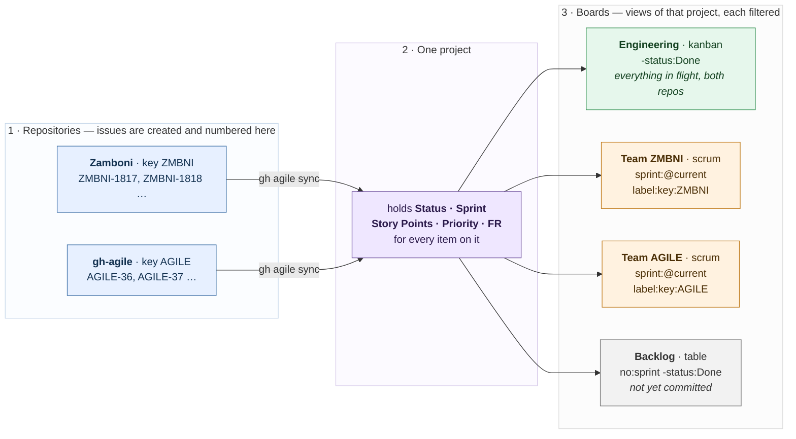
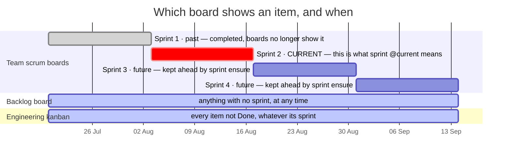

# gh-agile user guide

Setting up a board, and the commands for a real day's work — including the one
that takes an epic from created to closed. Written so a person can follow it and
an agent can run it on a developer's behalf.

The *rules* are in [POLICY.md](POLICY.md); the *data mapping* is in
[GOLD_MODEL.md](GOLD_MODEL.md). This is the *how*.

---

## 1. The project profile

One JSON file describes the project to the tool. It is **visible, checked in,
and reviewed like any other config**:

```
.github/agile.json
```

A dotfile would be the conventional choice for tooling and the wrong one here.
`ls` does not show it, so someone cloning the repo never learns the convention
exists — and a convention nobody discovers is not a convention. `.github/` is
already where people look for repository metadata, and the file sits beside the
workflows that read it.

### Properties

| Property | Type | Required | Description |
|---|---|---|---|
| `keys` | **ordered list** | yes | One entry per key: `{"key", "name", "repo"}`. **The order is the default** — the first entry for a repository is the key used when `--key` is not given |
| `keys[].key` | string | yes | Short uppercase key, `[A-Z0-9]+`. No hyphen: the hyphen separates key from number in `ZMBNI-34` |
| `keys[].repo` | string | yes | `owner/name` the key applies to. Several keys may name the same repo — see Mono-repo support |
| `keys[].name` | string | no | What that key is for, shown by `gh agile key` |
| `project.number` | integer | no | The board's **number**, not its node id — what `--project` takes. Written by `gh agile project create`, and what every command defaults to |
| `project.name` | string | no | Human-readable project name |
| `project.key` | string | no | The main repository's key; a convenience copy of the matching `keys` entry |
| `config_from` | string | no | `owner/repo` holding the real profile. **Carries nothing else** |

```json
{
  "keys": [
    { "key": "ZMBNI", "name": "Zamboni Iceberg table maintainer", "repo": "paulcaron16k/Zamboni" },
    { "key": "SPARK", "name": "Zamboni Spark maintainer",         "repo": "paulcaron16k/Zamboni" },
    { "key": "TRINO", "name": "Zamboni Trino maintainer",         "repo": "paulcaron16k/Zamboni" },
    { "key": "AGILE", "name": "GitHub Agile extension",           "repo": "paulcaron16k/gh-agile" }
  ],
  "project": {
    "number": 5,
    "name": "Zamboni Iceberg table maintainer",
    "key": "ZMBNI"
  }
}
```

**The key belongs to the repository, not the project.** GitHub's issue numbers
are a per-repository sequence and a project may span repositories, so a
project-level key would make `KEY-12` ambiguous the moment a second repository
joined the board.

A key gives the Jira equivalent of `{PROJECT_KEY}-{ISSUE_ID}`: **`ZMBNI-34`
identifies a repository and an issue in one string**, and is accepted anywhere
an issue number is.

### How an issue's key is decided, and where it is stored

**Explicitly, on the issue, as a label — `key:ZMBNI`.** Written at creation by
`epic` and `story`, so it is recorded rather than inferred.

GitHub Issue Fields would be the natural home and are unavailable:
`createIssueField` requires an **Organization** owner and refuses a user
account, the same limitation as Issue Types. A label is the next best carrier —
it lives on the issue rather than the board, shows in the UI, survives removal
from a project, and is filterable with `is:issue label:key:ZMBNI`.

On export, `issue_key` uses the `key:` label when present, and otherwise falls
back to the **first** profile key for that issue's repository.

### Mono-repo support

A product in one repository with several services — which would be separate
repos, or separate Jira projects with their own keys — can list **several keys
against the same repo**. `--key SPARK` on creation labels the issue
`key:SPARK`, and it exports as `SPARK-41`.

The ids are not monotonic per key: `ZMBNI-34` may be followed by `SPARK-35`,
because all keys share one repository sequence. That is a cosmetic difference
from Jira and a real advantage — the numbers **cannot collide**, where Jira's
per-project sequences require the key to disambiguate them.

### Where to check it in when a project spans repositories

**Put the real profile in the main repository** — the one whose name the project
carries, where most issues are filed. Supporting repositories carry a pointer
and nothing else:

```json
{ "config_from": "paulcaron16k/Zamboni" }
```

Resolved through the API, so it works for private repositories on the token `gh`
already holds, and cannot rot into a dead raw-content URL. One hop only: a
pointer to a pointer is a loop waiting to happen, so the tool ignores
`config_from` in a profile it has already followed.

Resolution order, first match wins: `.github/agile.json` → `agile.json` →
`.gh_agile.json`.

For consisency we recommend always store this file in `.github/agile.json`.

### CLI defaults

Typing `--project 5 --repo owner/name` on every command is friction, and
friction is what makes people skip the tool and edit by hand. So both are
inferred, and the inference is stated rather than clever.

**gh-agile must be run inside a git repository.** If it is not, it says so and
exits rather than guessing.

| What | Precedence, most explicit first |
|---|---|
| **Project** | `--project`, else `project.number` from the profile. Absent both, an error |
| **Repository** | `--repo`, else the repo named by `--key`, else the repository you are running in |
| **Key for a new issue** | `--key` — which must be listed for that repo — else the **first** key listed for that repo |
| **Issue** | `--issue 34` uses the repository resolved above; `--issue ZMBNI-34` names it itself, and then `--repo`/`--key` are not needed |

### One project per main repository

`gh agile project create` writes `project.number` into the profile, and refuses
to create a second while one is recorded:

```
the profile already names project #4. One project per main repository, because
project.number is what every command defaults to.
  To start a different project: remove project.number from the profile here, or
  work from the clone of that project's main repository.
```

A second board would make the default ambiguous, and an ambiguous default is
worse than typing the flag. `--force` overrides it for the case where you mean
it.

### What is *not* checked in

`.gh_agile_export.json` — the incremental-export watermark. That is state a
machine rewrites, not configuration a person writes, and deleting it to force a
full export must not lose your keys. Add it to `.gitignore`; it is deliberately
a separate file for that reason.

### Should the JSON go in the README?

**No.** Document the *properties* — as the table above does — and link to the
file. Pasting the authoritative copy into a second place is how the two drift,
and the drift is silent. A two-line example in a README is fine; the file is the
source.

---

## 2. Creating a project

Change directory to the main repo for this project. Files will be created which
need to be checked in.

```bash
# The board, with the project's key. Writes project.number into the profile,
# which is what every later command defaults to.
gh agile project create --title "Zamboni Iceberg table maintainer" --key ZMBNI

# Its fields and labels. Idempotent -- run it again after editing the spec.
gh agile setup

# Further keys, for a mono-repo holding several components.
gh agile key --key SPARK --repo paulcaron16k/Zamboni \
             --name "Zamboni Spark maintainer"
```

After this, `--project` and `--repo` are unnecessary in the same repository.

If a project is created in a repo where one already exists, as identified by a
existing profile .github/gh-agile.json with project.id = INT present, an errors
is printed and no over-writing action is taken. Manually remove the existing
profile project.id, or change to the folder where that new project main repo resides.

`setup` creates five fields. `Status` already exists with three options and
gains the two the policy declares:

| Field | Type | Values |
|---|---|---|
| `Status` | single-select | `Todo`, `In Progress`, `Blocked`, `In Review`, `Done` |
| `Story Points` | number | — |
| `Priority` | single-select | `lowest`, `low`, `medium`, `high`, `highest` |
| `FR` | text | requirement id, free text |
| `Sprint` | iteration | created separately, below |

Epics, parents and sub-issue progress need no custom field: GitHub provides
them.

## 3. Boards: scrum, kanban, backlog, roadmap

**One project, many boards.** A second project is almost always the wrong
answer, and the reason is field values: a `ProjectV2Item` belongs to exactly one
project and holds its own `Status`, `Story Points` and `Sprint`. An issue on two
projects therefore has **two independent sets** — move it to Done on the team
board and the engineering board still shows it In Progress, with nothing
reporting the divergence.

So an engineering board across every repo, and a team board for one or two keys,
are two **boards over one project**, each with its own filter.

### What a real setup looks like

Two repositories, one project, four boards. Every board shows a slice of the
same items with the same field values — nothing is copied, and nothing can
disagree.



Reading it:

- **Issues are born in a repository** and numbered there. `ZMBNI-1817` and
  `AGILE-36` cannot collide, because each key belongs to one repository.
- **`sync` puts them on the project.** Nothing arrives by matching a filter —
  see [Why `sync` exists](#why-sync-exists-a-project-is-a-collection-not-a-filter).
- **The project holds the planning state.** One `Status`, one `Sprint`, one
  estimate per item, wherever it is shown.
- **A team board is one filter away from the engineering board.** `Team ZMBNI`
  is `label:key:ZMBNI` plus the current sprint; `Engineering` drops both
  clauses. A story appearing on both is the *same* story, not a copy.

**Add a third repository** by giving it a key and running `sync`: it flows into
the same project, appears on `Engineering` immediately, and gets a team board of
its own by adding one filtered view. Nothing else changes.

### Sprints across the boards

The scrum boards show **one sprint** — whichever is current. The kanban and
backlog boards ignore sprints entirely, which is what makes them useful when a
sprint boundary is not the question.



- **Past sprints vanish from the scrum boards** the moment the next one starts,
  because `sprint:@current` is evaluated on every load. The items are not gone;
  they are on `Engineering` until Done, and in the export forever.
- **Future sprints exist before anyone needs them.** `sprint ensure` keeps two
  ahead, so committing a story to Sprint 3 is possible today.
- **The backlog is defined by absence** — `no:sprint`. An item leaves it by
  being given a sprint, which is what sprint planning *is* here.
- **An item can be on three boards at once** and has one status on all of them.
  That is the property a second project would destroy.

### Is a GitHub view a scrum board or a kanban board?

**Neither, until you filter it.** GitHub has no such concept — it has a *view*
with a layout and a filter. The filter is what makes it one or the other, and
the distinction is the ordinary Agile one:

| Board | What makes it that | Filter |
|---|---|---|
| **Scrum** | **Time-boxed.** Shows the work committed to the current iteration, and resets when the sprint does | `sprint:@current` |
| **Kanban** | **Continuous flow.** No iteration boundary; everything in flight at once, limited by WIP rather than by a sprint | `-status:Done` |
| **Backlog** | Not yet committed to an iteration | `no:sprint -status:Done` |
| **Roadmap** | Epics over time | `label:type:epic`, roadmap layout |

Same columns and same items in each; only the scoping differs. This is the
choice Jira makes at board creation, which is why the command names it the same
way:

```bash
gh agile board create --name "Team SPARK" --type scrum  --filter "label:key:SPARK" --save
gh agile board create --name "Engineering"  --type kanban --save
gh agile board create --name "Backlog"      --type backlog --save
gh agile board list
```
```
  #2   Team SPARK           scrum    board    sprint:@current label:key:SPARK
  #3   Engineering          kanban   board    -status:Done
  #4   Backlog              backlog  table    no:sprint -status:Done
```

`--filter` is ANDed with the type's own, so a scrum board for one key is the
type plus one clause. `--save` records the board in the profile, after which
`gh agile setup` converges it like any field — boards become reproducible rather
than hand-built.

Across repositories the team filter is `repo:owner/name`; in a mono-repo it is
`label:key:SPARK`, which is what the key label exists for.

**One honest limitation: WIP limits are not automatable.** A kanban board's
column limits are not exposed in the API — `ProjectV2View` has no limit field of
any kind — so if you want them, set them in the web UI. Everything else about a
board is reproducible from the profile.

**A view filters items already on the board; it does not pull them in.** The
project must contain everything any view should show.

### Why `sync` exists: a project is a collection, not a filter

The natural assumption is that a project is a *saved search* over a repository's
issues — that creating an issue makes it appear on the board, and that anything
matching a board's filter is on that board. **It is not.** A project is a
curated collection, and an issue is on it only because something put it there.

The reason is where the data lives. `Status`, `Story Points` and `Sprint` are
stored **per project item**, not on the issue — that is why the same issue can
sit on two projects with two different statuses. A project therefore *cannot* be
a filter: a filter has nowhere to put a value. The item has to exist first.

Two consequences that catch people out:

- **A board's filter narrows what is already on the project.** It never reaches
  out and pulls issues in. An engineering board filtered `repo:owner/other-repo`
  shows nothing at all until those issues are added to the project.
- **GitHub's built-in workflows help, and do not cover this.** They are worth
  understanding rather than dismissing — see the table below. One of them adds
  items automatically and is enabled by default; none of them adds an issue
  merely because it matches a board's filter.

### What the built-in workflows do

Checked on a live user-owned project rather than read from documentation — the
API lists six, and their names are the whole story:

| Workflow | Adds items? | Default |
|---|---|---|
| **Auto-add sub-issues to project** | **Yes** — a sub-issue of an item already on the board joins it automatically | **enabled** |
| Item added to project | No — reacts to an item that has just been added, e.g. to set its status | disabled |
| Item closed · Auto-close issue | No — react to items already on the board | disabled |
| Pull request merged · Pull request linked to issue | No | disabled |

**Keep `Auto-add sub-issues` enabled.** It does real work: every story created
as a sub-issue of a boarded epic arrives on the board without anything else
happening. That is why `gh agile story` never needs `sync`.

**What is missing is an auto-add by *filter*** — "put every issue in this repo
with this label on this board". GitHub does offer such a workflow, and it was
**not present on this user-owned project**: the six above are all there are.
That is the same pattern as Issue Types and Issue Fields, both of which turned
out to be organization-only.

And workflows cannot be automated from here in any case: the only mutation is
`deleteProjectV2Workflow` — none creates, enables or configures one — and
`ProjectV2Workflow` exposes no filter to read. So even where an auto-add exists,
it is a web-UI setting that cannot be reproduced from the profile.

So:

```bash
gh agile sync --dry-run                 # what is missing, changing nothing
gh agile sync                           # every repo in the profile keys
gh agile sync --repo owner/other-repo   # just one
gh agile sync --query "label:type:story" --state all
```
```
  added paulcaron16k/other-repo#12  Compact on a schedule
  added 1, already present 10, across 2 repo(s)
```

### How often, and what goes wrong if you do not

**GitHub recommends nothing about this**, because `sync` is not a GitHub
concept. GitHub's own answer to the same gap is the auto-add workflow, which
runs continuously on their side and is configured in the web UI.

**The board is never *stale*. It can be *incomplete*.** The distinction matters:

| | Needs sync? |
|---|---|
| Status, points, sprint, assignee on an item **already on the board** | **No.** Read live — a change shows immediately |
| Issues created by `gh agile epic` / `story` | **No.** Added at creation |
| Sub-issues of an epic already on the board | **No** — the built-in *Auto-add sub-issues* workflow is enabled by default |
| An issue filed in the web UI, or by `gh issue create`, or by any other tool | **Yes.** It is simply not on the board |

Measured, not assumed: an issue created with plain `gh issue create` in a repo
whose other issues are on the board did **not** appear on it. Nothing on the
board goes out of date; issues that were never added are absent, and everything
else is current the moment it changes.

**So do not run it before a meeting.** A correctness step that depends on
someone remembering it is a rota, not a process, and it fails on the week it
matters. Instead, in order of preference:

1. **Check the project's workflow settings for an auto-add.** If your project
   offers one — an organization-owned project may — enable it, and `sync`
   becomes a backfill tool rather than the mechanism. On the user-owned project
   tested here it was not available.
2. **Run `sync` on a schedule** otherwise: hourly or daily, from cron or a
   GitHub Action. Frequency only bounds how long a newly filed issue is missing
   from the board; nothing degrades in between, because nothing on the board is
   going out of date.

   Daily at 07:00, from the main repository's clone:

   ```cron
   PATH=/usr/local/bin:/usr/bin:/bin:/snap/bin
   HOME=/home/you
   LOG=/home/you/.local/state/gh-agile/sync.log

   0 7 * * *  cd /srv/projects/Zamboni && gh-agile sync >> $LOG 2>&1; tail -n 1000 $LOG > $LOG.tmp && mv $LOG.tmp $LOG
   ```

   **`cd` into the repository first, and it is not optional.** The profile is
   found relative to the working directory — `.github/agile.json` — and it is
   what supplies `--project` and the repositories to sync. Run from anywhere
   else and the tool exits saying it is not inside a GitHub repository, which is
   the right failure but a daily one.

   Three things that bite in cron and not in a shell:

   - **`PATH` is minimal**, which is why the crontab sets it. `gh-agile` shells
     out to `gh` for every call, so `gh` being unreachable fails the run as
     surely as `gh-agile` being unreachable. Check where yours is with
     `command -v gh` and include that directory. **On Ubuntu it is often
     `/snap/bin/gh`** — which no default cron `PATH` contains, and which is why
     `/snap/bin` appears above.
   - **Authentication must be non-interactive.** `gh` reads `GH_TOKEN` from the
     environment, or its stored credentials from `$HOME/.config/gh` — and cron
     may not set `HOME` to what you expect. Either export `GH_TOKEN` in the
     crontab, or set `HOME=/home/you` there.
   - **Keep the log, somewhere you can actually write.** `/var/log` is
     `root:syslog` and mode 755, so a *user* crontab redirecting there gets
     `Permission denied` and the run produces nothing — the log line fails
     before the command does. `~/.local/state/` is the XDG location for exactly
     this, and it is yours. **Create the directory once**; cron will not:

     ```bash
     mkdir -p ~/.local/state/gh-agile
     ```

     Without redirection cron mails the output or discards it, and the one run
     that added forty issues is the one you will want to read.

   - **Truncate it, or it grows forever.** The `tail`/`mv` at the end of the
     line keeps the last 1000 lines — a few months of daily runs. Writing to a
     temporary file and moving it is what makes this safe: `tail -n 1000 f > f`
     would truncate the file before `tail` read it, losing everything. `mv` over
     the same filesystem is atomic, so a reader never sees a half-written log.

     `LOG=` is a crontab variable; cron exports it and the shell running the
     command expands `$LOG`, which keeps the line readable rather than repeating
     the path three times.

     If the log genuinely belongs in `/var/log`, that is a *system* crontab —
     a file in `/etc/cron.d/` with a user field — not a user one. Or send it to
     syslog and let that place it:
     `... | logger -t gh-agile`.

   Verify the line works before trusting it, in the environment cron will use:

   ```bash
   env -i HOME="$HOME" PATH=/usr/local/bin:/usr/bin:/bin:/snap/bin \
     sh -c 'cd /srv/projects/Zamboni && gh-agile sync --dry-run'
   ```

   `env -i` clears the environment, so this fails the same way cron would
   rather than quietly succeeding on something your interactive shell
   exports. Both failures are named: outside a repository it says so, and
   without `gh` on `PATH` it says that too.

3. **Run it after the events that create a backlog**: adding a repository to the
   profile, a bulk import, a migration.

Issues created by `gh agile epic` and `gh agile story` are added at creation and
never need it.

**`sync` only adds.** It never removes an item, because removing one discards
that item's Status, Points and Sprint — the data lives on the project item, so
taking it off the board destroys it.

## 4. Creating sprints

```bash
gh agile sprint create --start 2026-08-17 --weeks 2
gh agile sprint create --weeks 2      # abuts the previous one
gh agile sprint list
```
```
  Sprint 1     2026-08-17 .. 2026-08-30  (current)
  Sprint 2     2026-08-31 .. 2026-09-13
```

Without `--start`, a new sprint begins the day after the last one ends, because
overlapping sprints make "the current sprint" ambiguous.

### Keeping sprints stocked

Creating a sprint by hand every fortnight is a rota, and a rota fails on the
week it matters. `ensure` guarantees a sprint covering today plus `ahead` more:

```bash
gh agile sprint ensure            # uses the profile's `ahead`
gh agile sprint ensure --ahead 4
```

Idempotent: it creates only the shortfall, so running it twice is a no-op. This
is Jira's model — future sprints waiting in the backlog — and it means starting
work never has to change the project's configuration.

```cron
0 7 * * 1  cd /srv/projects/Zamboni && gh-agile sprint ensure >> $LOG 2>&1
```

Configuration lives in the profile:

| Property | Default | Description |
|---|---|---|
| `cadence_days` | `14` | Sprint length, 1–30. `"2-week"` is accepted and normalised |
| `start_day` | `"monday"` | Weekday new sprints begin on |
| `ahead` | `2` | Future sprints `ensure` keeps |
| `autocreate` | `true` | Whether `move` may create one as a fallback |
| `name_template` | `"{key} Sprint {n}"` | `{n}`, `{key}`, `{start}`, `{end}`, `{year}`, `{iso_week}` |

The template is `str.format`, not Jinja: this tool has no dependencies and
Jinja2 would be its only one. The default follows Jira's `<Board> Sprint <n>`,
so a board keyed `ZMBNI` produces `ZMBNI Sprint 3`. Sprints created before you
set a template keep their names — renaming them would rewrite the sprint every
historical item points at.

**A sprint created today starts on the last `start_day`, not today.** Asked for
on a Wednesday with `start_day: monday`, it runs Monday to Sunday and already
covers two days of the past. That is deliberate: sprints landing on the same
weekday are what a team can plan around, and it is what Jira does.

**Gaps are skipped, not backfilled.** After an idle month, `ensure` creates the
sprint covering today and numbering jumps — `Sprint 2` to `Sprint 5` — rather
than inventing sprints nobody worked in.

**One sprint back, if the series starts after today.** A first sprint created by
hand on a chosen date leaves everything before it uncovered, and the aligned
window for today would overlap it. `ensure` then steps back from the earliest
sprint by exactly one cadence, which covers today *and* abuts the series. It
never walks back further: filling months of history with sprints nobody worked
in is the backfilling this avoids.

If neither placement works it says so — `no sprint covers today (2026-08-16);
the next starts 2026-08-17` — rather than reporting success. Sprint names are
assigned by count, so a sprint placed before the series can be numbered after
it. The dates are the truth; renaming would clear every assignment, since
iterations carry no id.

**If `ensure` has not run, `move` covers for it.** Moving a story to
`In Progress` with no active sprint creates one and says so; set
`autocreate: false` to have it warn and leave the field empty instead.

> **Every change to the sprint configuration clears existing sprint
> assignments**, and this is GitHub's behaviour rather than a choice. The
> configuration is replaced wholesale and `ProjectV2Iteration` — the only input
> accepted — carries `startDate`, `duration` and `title` and **no id**, so each
> update mints new iteration ids and orphans every item pointing at an old one.
> Verified by appending one sprint while re-sending the others identically: the
> assignment vanished. `gh agile` therefore reads every assignment, makes the
> change, and re-applies them, reporting how many it restored. Changing the
> configuration in the **web UI** has no such protection.

> `start_day` is this tool's alignment rule, not a GitHub setting. The API's
> configuration input has no `startDay`, and GitHub does not derive one from a
> start date — sending a Monday left the field reporting Sunday. It affects only
> what the web UI suggests. `setup` therefore converges `cadence_days` and
> leaves `startDay` alone.

## 5. Creating an epic and a story

```bash
gh agile epic "Snapshot expiry and orphan removal" \
  --intent "Nothing reclaims storage; 120 files on disk and 1 live after five days." \
  --acceptance "expire and remove-orphans delete only unreferenced files, and abort otherwise."

gh agile story "Compute the reachable file set" --epic 31 \
  --points 5 --priority highest \
  --intent "Both operations depend on it; an omission here deletes live data." \
  --acceptance "Every referenced file across all six metadata categories is returned."
```

The story is created, attached to its epic as a sub-issue, added to the board and
given its fields **in one call**. That matters: an issue created now and attached
to its epic later is an orphan in every roll-up run in between, and nothing
complains.

---

## 6. The workflow, end to end

A story from creation to closed, then its epic. Every command here is
non-interactive, so an agent can run the same sequence.

**1 — the epic exists**

```bash
gh agile epic "Snapshot expiry and orphan removal" --intent "..." --acceptance "..."
#   epic #31: Snapshot expiry and orphan removal
```

**2 — a story under it**

```bash
gh agile story "Compute the reachable file set" --epic 31 \
  --points 5 --priority highest --intent "..." --acceptance "..."
#   story #32 under epic #31    (labelled key:ZMBNI, so it is ZMBNI-32)
```

**3 — start work; the sprint follows**

```bash
gh agile move ZMBNI-32 --status "In Progress"
#   #32 Status = In Progress
#   #32 Sprint = Sprint 1 (current)
```

**Starting work puts the item in the current sprint** if it is not in one
already. Anything else means in-progress work sitting outside every sprint, and
a sprint report that quietly omits it. With no active sprint it warns and
continues — declining to start work because nobody made a sprint would be the
tool making a process decision.

To place it in a different sprint, say so:

```bash
gh agile set --issue ZMBNI-32 --field Sprint --value "Sprint 2"
```

No evidence is required to start. Requiring it here would be ceremony; requiring
it to finish is the point.

**5 — fixed, with evidence**

```bash
gh agile move ZMBNI-32 --status Done --evidence-file evidence.md --close
```

where `evidence.md` is:

```markdown
## Evidence
Reference set validated read-only against the demo table: 421 referenced,
426 on disk, 0 referenced-but-absent. Each of the six categories asserted
non-empty, so a silently dropped category fails the test.
```

Three ways to supply it, and one that only works for a human:

| Form | Use |
|---|---|
| `--evidence-file notes.md` | An agent, CI, or anyone who wrote it down first |
| `--evidence "text"` | A one-liner |
| `--evidence-file -` or `--evidence -` | A pipe: `git log -1 \| gh agile move …` |
| *(nothing, at a terminal)* | Prompts section by section |

**The body is validated, not merely templated.** `Done` requires `## Evidence`,
and the transition is refused if the section is missing, empty, or still `_TBD_`:

```
the body is not complete:
  - ## Evidence is still _TBD_
```

`--close` closes the issue as completed; `--not-planned` closes it as not
planned, so work that stopped for another reason stays distinguishable in the
export.

**6 — close the epic**

```bash
gh agile move ZMBNI-31 --status Done --evidence-file epic-evidence.md --close
```

Close it when its stories are closed. `gh agile validate` reports an epic marked
`Done` with open children.

**7 — check and export**

```bash
gh agile validate
gh agile export --csv --out-dir exports/
```

---

## 7. For an agent working on a developer's behalf

Everything above is non-interactive when given explicit input, which is the
property that makes it drivable. A working sequence:

```bash
# No --project or --repo: both come from the profile and the working directory.
# $ISSUE may be 32 or ZMBNI-32.

# Pick up the work, and say so on the board. The current sprint follows.
gh agile move "$ISSUE" --status "In Progress"

# ... make the change, run the tests ...

# Record what was actually established, from a file the agent wrote.
cat > /tmp/evidence.md <<'EOF'
## Evidence
491 tests pass on the branch. The regression reproduces on 0.12.0rc1 and not
after the fix, verified by running the 25-line case against both.
EOF

gh agile move "$ISSUE" --status Done --evidence-file /tmp/evidence.md --close
```

Two rules worth encoding in whatever drives it:

- **Never pass `_TBD_` to get past the validator.** The check exists because a
  closed issue saying "done" has thrown away the reasoning. An agent that
  defeats it has removed the only durable record of why the change was right.
- **Evidence is what was measured**, not what was intended — that is
  `## Intent`, written at creation. If nothing was measured, the honest evidence
  says so.

---

## 8. Exporting issues and events

Two grains, because they answer different questions and cannot share a file:

| Grain | One row per | Gold table |
|---|---|---|
| `issues` | work item, every custom field flattened, joined to its status history | `agile_issues` |
| `events` | thing that happened — status change, assignment, label, close, reopen | `agile_events` |

```bash
gh agile export --grain both --csv --out-dir exports/
```
```
  full export: 24 row(s)
  163 event row(s)
  wrote exports/AGILE/agile_issues_20260816T031917Z.csv
  wrote exports/AGILE/agile_events_20260816T031917Z.csv
```

**Events cost no extra API calls.** The expensive part of an export is the
timeline query, one per issue, and it already runs to produce the history
columns — `started_at`, `done_at`, `cycle_time_days`. The event grain is that
same data reshaped.

**Output goes under the project key**, so several projects can export into one
tree without colliding and a loader can tell whose rows it is reading from the
path alone: `--out-dir exports/` writes `exports/AGILE/…`.

Event rows carry `event_hash`, a digest of issue, event type and timestamp,
stable across exports. An overlapping incremental run re-emits the same event
with the same hash, so the target overwrites rather than duplicating.

### A daily incremental export

06:00 UTC, both grains, into a per-key folder:

```cron
CRON_TZ=UTC
PATH=/usr/local/bin:/usr/bin:/bin:/snap/bin
HOME=/home/you
LOG=/home/you/.local/state/gh-agile/export.log

0 6 * * *  cd /srv/projects/Zamboni && gh-agile export --grain both --csv --out-dir /srv/exports >> $LOG 2>&1; tail -n 1000 $LOG > $LOG.tmp && mv $LOG.tmp $LOG
```

`CRON_TZ=UTC` because cron otherwise uses the system timezone, and a job named
for one clock and scheduled by another is a confusion that surfaces months
later. The watermark makes each run incremental; the first is a full export.

### Compacting and measuring: an optional companion

**The extension has no dependencies, and cannot have any.** `gh extension
install` clones the repository and installs nothing — there is no dependency
step for a script extension — so an `import duckdb` inside `gh-agile` would
break every install that happened not to have it. It is standard library only,
permanently.

Analysis lives in a companion script, which declares its dependency with PEP 723
inline metadata so `uv` fetches it into an ephemeral environment:

```bash
uv run scripts/agile_analytics.py --dir /srv/exports/ZMBNI compact
uv run scripts/agile_analytics.py --dir /srv/exports/ZMBNI metrics
```

`compact` folds the daily files into one per month, keeping the newest row per
key — `number` for issues, `event_hash` for events — so the overlap incremental
export deliberately creates collapses:

```
  agile_issues_monthly_202608.csv: 24 row(s) from 2 daily file(s)
  agile_events_monthly_202608.csv: 158 row(s) from 2 daily file(s)
```

48 daily issue rows became 24. `--keep` leaves the dailies in place.

`metrics` reports six numbers per period, as a matrix — metrics down, periods
across:

```bash
uv run scripts/agile_analytics.py --dir /srv/exports/ZMBNI metrics \
    --time-range quarterly --context key
```
```
  context                    2025-Q3    2025-Q4    2026-Q1    2026-Q2  2026-Q3 in-progress
  throughput                       0          0          0          0                   14
  points_done                    0.0        0.0        0.0        0.0                 54.0
  created                          0          0          0          0                   24
  cycle_time_median                                                                    0.0
  lead_time_median                                                                    0.45
  carryover                        0          0          0          0                    1
  AGILE - throughput               0          0          0          0                   14
  …
```

| Metric | Answers |
|---|---|
| `throughput` | items reaching Done |
| `points_done` | story points completed |
| `created` | items created |
| `cycle_time_median` | median days *In Progress* → *Done* |
| `lead_time_median` | median days on the board → *Done* |
| `carryover` | started but not finished |

`--time-range quarterly|monthly|yearly`, four complete periods plus the one in
progress. **Quarters start 1 January**, so the boundaries match a planning cycle
rather than counting back from today. The final column is labelled
`in-progress` because a third of a quarter otherwise reads as a collapse.

Weekly and daily are deliberately not offered: a fortnight's throughput on a
small team is three items and a week's is one, and a number that swings 100% on
a single story says nothing about the process.

`--context project` totals everything; `--context key` adds a row per key,
labelled `AGILE - throughput`. A project with one key shows identical project
and team rows, which is correct rather than redundant. `--start-date` drops
periods ending before it.

DuckDB rather than pandas: it reads a glob of CSVs directly, deduplicates with a
window function and writes CSV in one statement, and nothing has to fit in
memory. Either would work; this is less code.

Monthly, after that day's export:

```cron
0 7 1 * *  cd /srv/projects/Zamboni && uv run scripts/agile_analytics.py --dir /srv/exports/ZMBNI compact >> $LOG 2>&1
```

## 9. Who did the work

An **assignee is a point-in-time value**. It is the developer while a story is
in progress, then often a reviewer, then QA. It answers "who has this now",
which a board needs and a report cannot use.

**An event answers who did what, and when** — and that is the durable record.
`github_events` carries `actor_name` on every row, so the question "which
developer fixed this" is answered by the actor of `change-request-opened`: the
person who opened the pull request that closed the issue. That is a fact about
an action, not a mutable field somebody may have changed since.

*Why* is not recorded. It would have to be synthesised from commit messages or
a pull request body, and an invented summary is worse than a null.

`github_issues` carries the derivation ready-made:

| Column | From |
|---|---|
| `reported_by` | `Issue.author` — who opened it. GitHub's cannot be changed after the fact, where Jira's reporter can, so it is the firmer of the two |
| `worked_by` | The closing pull request's author; failing that, whoever first moved the issue into *In Review* or *Done* |
| `closing_pr` | That pull request's number, or empty |

The fallback is weaker on purpose and labelled as such: a status change records
who *clicked*, which is usually the developer and sometimes whoever was running
the standup. The pull request author is a fact; the card-mover is an inference.

### Do you need the two GitHub automations?

**Neither is required. Both are good practice, for the board rather than the
report.**

| | What it does | Verdict |
|---|---|---|
| Built-in workflow **"Pull request linked to issue"** | Moves an item's status when a PR is linked, so Todo → In Progress happens without anyone dragging | **Best practice.** Enable it in the project's workflow settings. It cannot be automated: the API can only *delete* a workflow, so this is a UI setting and is not reproducible from the profile |
| `.github/workflows/auto-assign.yml` | Adds the PR author to the closing issues' assignees | **Best practice**, and cheap — a template ships in `templates/`. It needs only `permissions: issues: write`, which the default `GITHUB_TOKEN` grants for the same repository. **No stored credential**, unlike anything writing to a project |

Neither is *required* because `worked_by` is derived at export time from the
same `closingIssuesReferences` edge the workflow reads. The export is therefore
correct on history that predates either automation — which is the argument for
deriving rather than depending on somebody having switched something on.

The template assigns **additively**. An existing assignee is a deliberate act,
a reviewer or QA taking the story on, and replacing it with the author would
destroy the very information the board is there to show.

## 10. Command reference

Every command lists its own fields with type, obligation and description:

```bash
gh agile setup --help
gh agile story --help
gh agile move --help
```

| Command | Does |
|---|---|
| `setup` | Create fields and labels; converge on re-run |
| `key` | Record a repository's key; list what is recorded |
| `board list` / `board create` | Scrum, kanban, backlog and roadmap boards over one project |
| `sync` | Add issues that belong on the board and are not on it |
| `sprint list` / `sprint create` | Show or append iterations |
| `epic` / `story` | Create work items with their parent, labels and fields |
| `set` | Set one field on an item already on the board |
| `move` | Change status, with the evidence that status requires |
| `validate` | Check the conventions a machine can check |
| `export` | Issues and events, full or incremental, to stdout or timestamped files |
| `self-test` | Stand up a scratch project, exercise everything, tear it down |
